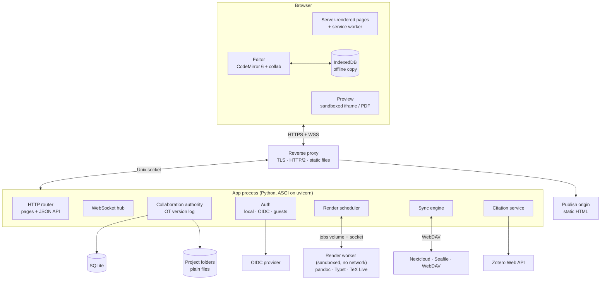
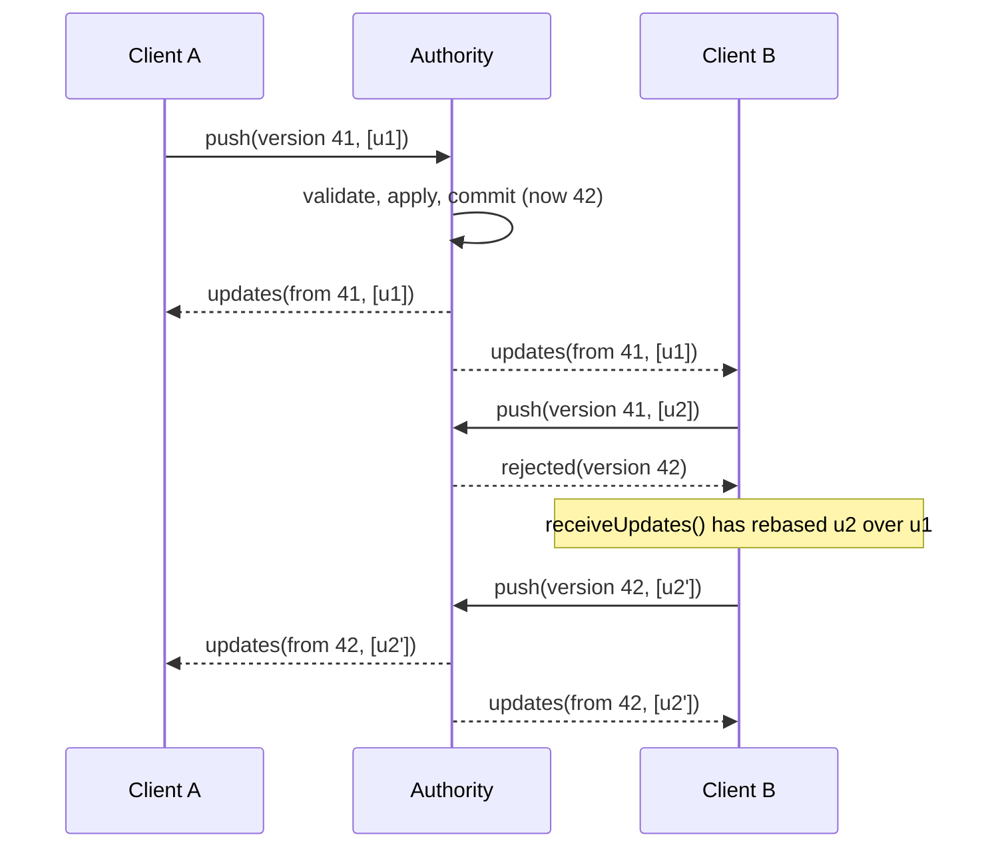
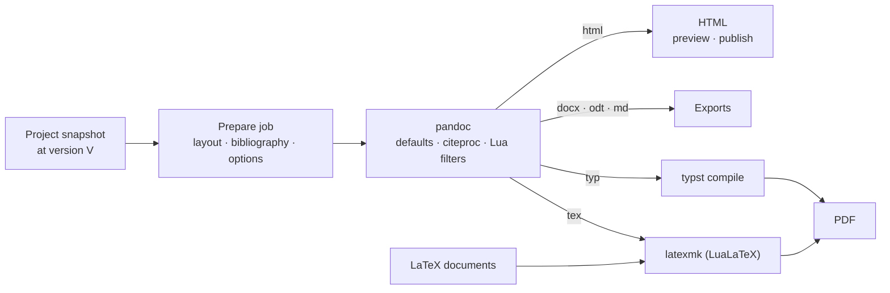

# DocWizard — Architecture

> Status: draft 0.5 · Last updated: 2026-11-13 · License: AGPL-3.0-or-later

This document describes what DocWizard is for, how it is built and why. It is the reference for contributors and self-hosters. When the code and this document disagree, fix one of them.

## Contents

1. [Purpose](#1-purpose)
2. [Goals and non-goals](#2-goals-and-non-goals)
3. [Design principles](#3-design-principles)
4. [System overview](#4-system-overview)
5. [Repository structure](#5-repository-structure)
6. [Frontend](#6-frontend)
7. [Backend](#7-backend)
8. [Collaboration](#8-collaboration)
9. [Rendering and layouts](#9-rendering-and-layouts)
10. [Citations and Zotero](#10-citations-and-zotero)
11. [Storage](#11-storage)
12. [Sync](#12-sync)
13. [Accounts, authentication and authorization](#13-accounts-authentication-and-authorization)
14. [Sharing, guests and publishing](#14-sharing-guests-and-publishing)
15. [Security model](#15-security-model)
16. [Performance budget](#16-performance-budget)
17. [Dependencies](#17-dependencies)
18. [Deployment and operations](#18-deployment-and-operations)
19. [Configuration](#19-configuration)
20. [Testing](#20-testing)
21. [Roadmap](#21-roadmap)
22. [Key decisions](#22-key-decisions)
23. [Open questions](#23-open-questions)
24. [Glossary](#24-glossary)
25. [Design guide](#25-design-guide)

---

## 1. Purpose

DocWizard is a self-hostable, copyleft editor for structured writing: term papers, theses, articles, reports and documentation. Authors write plain text, pandoc Markdown first and LaTeX where needed. How the output looks comes entirely from **layouts**: versioned bundles of templates, styles and settings. There is no WYSIWYG formatting.

DocWizard should:

- feel as fast as a native app: open instantly, type without lag;
- make collaboration as easy as sending a link;
- produce submission-ready output (PDF, Word, HTML) with correct citations and bibliographies;
- keep documents as ordinary files that sync to Nextcloud, Seafile or any WebDAV server;
- run as one small deployment with very few dependencies.

**Primary users**

- Students and researchers writing citation-heavy papers (Chicago author-date by default, any CSL style).
- Small groups such as classes, labs, associations and companies that want a self-hosted shared editor.
- Admins who want something boring to operate: one data directory, one config file, few moving parts.

## 2. Goals and non-goals

### Goals

| ID | Goal | Measure |
|---|---|---|
| G1 | Fast loading | Editor shows text in < 300 ms on repeat visits and < 1 s cold (see [§16](#16-performance-budget)) |
| G2 | Native-feeling editing | Typing never waits on the network or the renderer; IME, mobile input, spellcheck and undo behave like a native text field |
| G3 | Layouts, not WYSIWYG | All visual formatting lives in layouts; documents contain only content and meaning |
| G4 | Markdown first, LaTeX capable | Pandoc Markdown is the primary format; LaTeX documents compile to PDF live |
| G5 | Exports through pandoc | HTML, PDF, DOCX, ODT, Markdown (source and resolved), LaTeX and Typst source |
| G6 | Academic writing | CSL citations (Chicago author-date default), Zotero, bibliographies, footnotes, cross-references, word count |
| G7 | Easy collaboration | Real-time co-editing, presence, comments, share links with roles, guests |
| G8 | Files stay files | Plain files on disk; two-way sync with Nextcloud, Seafile and any WebDAV server |
| G9 | Identity | Local accounts, admin management, guests, OIDC |
| G10 | Publishing | Publish a document as a static HTML site |
| G11 | Little difficult code of our own, few dependencies | Policy in [§17](#17-dependencies); 11 Python packages at runtime |
| G12 | Easy to host | One compose file; back up one directory |

### Non-goals (v1)

- WYSIWYG or direct manipulation of page layout.
- Track changes in the document. Comments, suggestions and suggest mode ([§8.10](#810-suggestions)), named versions and the history cover review.
- Peer-to-peer collaboration or long-lived offline branches.
- More than one app process per instance (no horizontal scaling).
- Spreadsheets, slides, drawings.
- Native mobile apps. The web app is responsive.
- Managing TeX packages from the UI.

## 3. Design principles

1. **Text is the source of truth.** A document is plain text. Layout is applied at render time and never stored in the text.
2. **One renderer.** Pandoc decides what output looks like. The editor shows structure and meaning and never imitates the final page. The preview always comes from the real pipeline.
3. **Files stay files.** Every project is also a normal folder of normal files, kept current within seconds and editable from outside. The database holds the authoritative edit history ([§11.2](#112-canonical-state)), but nothing is locked in: the folder on its own is a complete, portable copy of the project.
4. **Dependencies must earn their place.** A dependency is accepted only if it replaces security-critical or edge-case-heavy code, brings few or no transitive dependencies, comes from an established project and can be pinned ([§17](#17-dependencies)).
5. **Fast by construction.** Server-rendered pages, no framework, nothing loaded before it is needed, size budgets checked in CI.
6. **Everything is untrusted.** Documents, layouts, uploads, remote servers and identity providers are treated as hostile input. Anything that executes code runs in a sandbox.
7. **Boring operations.** One process, SQLite, a config file, logs on stdout.

## 4. System overview



| Component | Runs where | Responsibility |
|---|---|---|
| Browser app | User's browser | Server-rendered pages enhanced with vanilla JS; CodeMirror editor; preview; offline cache |
| Reverse proxy | Own container or host | TLS, HTTP/2, compression, static files, publish origin |
| App process | One Python process | HTTP and WebSocket, auth, collaboration authority, render scheduling, sync, citations |
| SQLite | App data directory | Metadata, operation log, sessions, settings |
| Project folders | App data directory | Canonical plain files per project |
| Render worker | Sandboxed container (or bubblewrap) | Runs pandoc, Typst and LaTeX with no network |
| External services | Internet or LAN | WebDAV servers, Zotero Web API, OIDC providers |

### Key flows

**Opening a document**

1. The browser requests `/p/<project>/<path>`. The app returns a small HTML shell with the latest snapshot of the document embedded as JSON.
2. The editor compares the embedded snapshot with its IndexedDB copy and starts from whichever is newer, always keeping unconfirmed local edits. Offline, the service worker serves a shell without a snapshot, and the editor opens the IndexedDB copy ([§6.5](#65-offline-and-caching)).
3. The editor opens the WebSocket, sends its synced version, receives the updates it missed and sends its unconfirmed edits.

**Typing**

1. CodeMirror applies the edit locally. No network is involved.
2. The collab plugin sends the update. The authority validates, applies, persists and broadcasts it.
3. The materializer writes the text to disk a few seconds after activity stops.

**Preview**

1. About 300 ms after typing pauses, the client asks for a render of `(document, version, target, layout, options)`.
2. The scheduler dedupes requests across collaborators, checks the cache and queues a job.
3. The worker runs pandoc (and Typst or LaTeX for PDF). The client is notified and loads the result.

**External change** (someone edits the file in Nextcloud)

1. The sync engine sees a changed ETag, downloads the file and reconciles it against the last synced base ([§12.3](#123-reconciling-outside-edits)).
2. Non-overlapping changes are applied to the authority as an ordinary update, so open editors see them live. Overlapping changes become visible conflicts instead of blended text.

## 5. Repository structure

```text
docwizard/
├── ARCHITECTURE.md
├── README.md
├── LICENSE                          AGPL-3.0-or-later
├── pyproject.toml
├── requirements.lock                pinned with hashes
├── server/docwizard/
│   ├── __main__.py                  CLI: serve, migrate, create-admin, backup, check, rotate-key
│   ├── config.py                    docwizard.toml (tomllib) + environment overrides
│   ├── asgi.py                      ASGI entry: http / websocket / lifespan
│   ├── http/
│   │   ├── router.py                routes, middleware chain
│   │   ├── request.py               query, cookies, JSON, raw bodies, limits
│   │   ├── response.py              HTML / JSON / file responses, security headers
│   │   ├── csrf.py
│   │   └── templates.py             Jinja2 environment, autoescaping always on
│   ├── pages/                       handlers for server-rendered pages: home, login, settings, admin, share
│   ├── templates/                   Jinja2 templates for those pages and emails
│   ├── api/                         JSON API handlers, one module per area
│   ├── db/
│   │   ├── database.py              writer thread, read connections, group commit
│   │   ├── migrate.py
│   │   └── migrations/              0001_init.sql, 0002_….sql
│   ├── auth/
│   │   ├── passwords.py             scrypt, password policy
│   │   ├── sessions.py
│   │   ├── totp.py
│   │   ├── oidc.py                  discovery, code flow + PKCE, claim mapping
│   │   ├── jwt.py                   ID token verification via joserfc, JWKS cache
│   │   ├── throttle.py
│   │   └── permissions.py           the single place for access checks
│   ├── projects/
│   │   ├── service.py               projects, documents, assets, members, recent
│   │   ├── files.py                 safe paths, atomic writes, quotas
│   │   └── materializer.py
│   ├── collab/
│   │   ├── changeset.py             apply, map_pos, compose, map, from_diff (UTF-16)
│   │   ├── authority.py             rooms, versions, validation, persistence
│   │   ├── hub.py                   WebSocket connections, protocol, presence
│   │   ├── merge.py                 reconciliation of outside edits, conflicts
│   │   └── comments.py
│   ├── render/
│   │   ├── scheduler.py             debounce, dedupe, cache keys, cancellation
│   │   ├── jobs.py                  job directories, job.json
│   │   ├── worker_client.py         socket protocol to the worker
│   │   ├── layouts.py               manifests, inheritance, options, approval
│   │   ├── diagnostics.py           Typst / LaTeX error parsing
│   │   └── publish.py
│   ├── citations/
│   │   ├── zotero.py                Zotero Web API client
│   │   ├── library.py               CSL-JSON cache, citation key assignment
│   │   └── sources.py
│   ├── sync/
│   │   ├── webdav.py                PROPFIND / GET / PUT / DELETE / MKCOL via urllib
│   │   ├── engine.py                per-target state machine (§12.2)
│   │   └── nextcloud.py             Login Flow v2
│   ├── sharing/links.py
│   ├── admin/
│   ├── netpolicy.py                 outbound request policy (SSRF protection)
│   ├── secretbox.py                 AES-256-GCM for stored secrets, key rotation
│   └── mail.py                      smtplib
├── worker/
│   └── docwizard_worker.py          stdlib only: socket server, sandboxed job runner
├── web/
│   ├── app/
│   │   ├── main.js                  page bootstrapping
│   │   ├── editor/
│   │   │   ├── setup.js             CodeMirror composition
│   │   │   ├── pandoc-syntax.js     @lezer/markdown extensions for pandoc Markdown
│   │   │   ├── live-preview.js
│   │   │   ├── commands.js          list continuation, formatting, Markdown commands
│   │   │   ├── citations.js         autocomplete, chips, insert dialog
│   │   │   ├── math.js              Temml widgets (lazy)
│   │   │   ├── latex-mode.js        StreamLanguage tokenizer for LaTeX
│   │   │   ├── grammar.js           grammar underlines and fixes (§6.8)
│   │   │   └── diagnostics.js
│   │   ├── collab/
│   │   │   ├── socket.js            reconnecting, multiplexed WebSocket
│   │   │   ├── peer.js              @codemirror/collab glue
│   │   │   └── presence.js
│   │   ├── preview/
│   │   │   ├── html.js
│   │   │   └── pdf.js
│   │   ├── store/idb.js
│   │   ├── ui/                      DOM helpers, dialogs, command palette, panels
│   │   └── workers/
│   │       ├── citations.js
│   │       ├── grammar.js           Harper (§6.8)
│   │       ├── grammar-text.js      what isn't checked, which checker
│   │       └── stats.js
│   ├── css/app.css                  the only stylesheet (§25.13)
│   ├── icons.svg                    icon sprite (§25.9)
│   ├── i18n/                        en.json, de.json
│   ├── sw.js
│   └── vendor/
│       ├── MANIFEST                 versions, licenses, SHA-256
│       ├── codemirror.js            bundled CodeMirror + Lezer
│       ├── temml/
│       └── pdfjs/                   optional
├── layouts/                         built-in layouts: default, term-paper, article
├── filters/                         pre-approved Lua filters: crossref.lua, wordcount.lua, pagebreak.lua
├── csl/                             bundled CSL styles
├── deploy/
│   ├── Dockerfile.app
│   ├── Dockerfile.worker            build arg TEX=none|full
│   ├── Dockerfile.proxy
│   ├── compose.yaml
│   ├── compose.ssl.yaml
│   ├── Caddyfile
│   ├── Caddyfile.ssl
│   └── systemd/
├── scripts/
│   ├── vendor.sh                    dev-only: fetch and bundle frontend dependencies
│   ├── check_deps.py                fails CI on unlisted dependencies
│   └── bench_render.py
└── tests/
    ├── unit/
    ├── property/
    ├── integration/
    ├── e2e/
    └── fixtures/                    reference papers, tokens, WebDAV responses
```

Layering rules:

- `http/`, `pages/` and `api/` may call services, but services never import from them.
- All permission checks go through `auth/permissions.py`.
- Only `render/worker_client.py` talks to the worker. Only `sync/` and `citations/` (through `netpolicy.py`) make outbound requests.
- The worker shares no code with the app except the job format, which is documented in [§9.2](#92-render-jobs).

## 6. Frontend

### 6.1 Constraints

- Plain HTML, CSS and JavaScript (ES2022 modules). No framework, no transpiler, no build step at runtime.
- Third-party code lives in `web/vendor/`, pinned with checksums in `web/vendor/MANIFEST`. When versions change, `scripts/vendor.sh` (dev-only, uses esbuild) bundles CodeMirror and Lezer into one minified module.
- Our own modules are served as they are, wired up with an inline import map plus `modulepreload` hints. Browsers apply `script-src` to import maps, so the import map carries the per-response CSP nonce ([§15](#15-security-model)).
- All static assets are served under a per-release prefix, `/static/<release>/…`, with `Cache-Control: immutable`. A new release gets a new prefix, so no per-file hashing is needed. The release id is the version or git commit.
- Target browsers: the last two major versions of Firefox, Chromium-based browsers and Safari. MathML Core, import maps, `:has()`, the `popover` attribute and CSS `light-dark()` are assumed.

### 6.2 Pages

| Route | Rendering | Notes |
|---|---|---|
| `/` | Server | Pinned and recent documents, projects. Works without JS |
| `/login`, `/register`, `/reset` | Server | |
| `/p/<project>/<path>` | Server shell + JS | Editor; the document snapshot is embedded |
| `/s/<token>` | Server | Share-link landing page; guest name prompt |
| `/settings/…` | Server + JS | Profile, security, citation sources, sync targets, layouts |
| `/admin/…` | Server + JS | See [§13.6](#136-admin) |
| `/source` | Server | AGPL source offer ([§17.4](#174-licensing)) |
| `/sw.js` | App | Service worker, generated per release, `no-cache` |
| `/_shell/home`, `/_shell/editor` | App | Offline shells without server data, precached by the service worker ([§6.5](#65-offline-and-caching)) |
| `<preview origin>/_preview/<token>/…` | App | HTML previews and their assets on a separate origin ([§6.4](#64-preview)) |

Server-rendered pages use Jinja2 templates (`server/docwizard/templates/`) with autoescaping always on. Values are escaped unless explicitly marked safe, and CI fails if `|safe` or `Markup()` appears outside a short, reviewed list.

The editor shell embeds the snapshot as `<script type="application/json" id="snapshot">`. Inside it, every `<` is written as the JSON escape `\u003c` (and `>`, `&`, U+2028 and U+2029 are escaped the same way), so document text such as `</script>` can never close the tag. JSON data blocks are not executed, so they need no CSP nonce.

### 6.3 Editor

**Composition**

- CodeMirror packages: `state`, `view`, `commands` (keymaps, history), `language` (syntax tree, folding, indentation), `search`, `autocomplete`, `collab`.
- Markdown parsing uses `@lezer/markdown` with its GFM extensions plus our own **pandoc extensions** in `editor/pandoc-syntax.js`:
  - YAML front matter
  - citations (`[@key, p. 4]`, `@key`, `[-@key]`)
  - inline and display math (`$…$`, `$$…$$`)
  - fenced divs (`::: {.note}`) and bracketed spans
  - attributes (`{#fig:map .wide}`)
  - inline footnotes (`^[…]`)
  - raw blocks (`` ```{=latex} ``)
  - definition lists
- `@codemirror/lang-markdown` is deliberately **not** used, because it pulls in HTML, CSS and JavaScript language support. List continuation on Enter and the other Markdown commands live in `editor/commands.js`.
- LaTeX documents use our own `StreamLanguage` tokenizer in `editor/latex-mode.js` (commands, environments, math, comments).

**Live preview** (`editor/live-preview.js`)

A view plugin over the syntax tree. On every line except the one with the cursor, it:

- hides syntax marks (`**`, `#`, link URLs) and styles the content (heading sizes, emphasis);
- renders inline and display math as MathML widgets via Temml, which is loaded the first time a document contains math;
- shows citations as chips (`Smith 2020`) resolved from the citation library, and underlines unknown keys as errors;
- renders task-list checkboxes, footnotes as numbered chips (a click opens the note to edit), and optional image thumbnails;
- shows cross-references (`[@fig:map]`) as chips that read *Figure 1*, *Table 2*, numbered as crossref.lua numbers them, and marks references to labels that don't exist;
- hides `{#…}` attributes and sets pipe tables in a monospaced font so their columns line up while they're edited.

Pipe tables (`editor/table-view.js`) show as tables, with their header, alignments, inline formatting and caption, unless the selection is in them; wide ones scroll sideways inside the text. A click on a cell puts the cursor in that cell of the source, where the table bar takes over. In the review view tables always show as tables.

The line with the cursor shows raw source, unless *Show Markdown marks* (¶ in the toolbar, remembered per browser) is off: in this **writer mode** the marks stay hidden on the cursor's line too, and links, footnotes and figures are edited through their popovers. **Plain text editing** (*Plain* in the toolbar, or *Actions → Plain text editing*, remembered per browser) turns all of this off: no live preview, title card, figures or tables, just the Markdown in a monospaced font with its syntax colours. The rendering extensions sit in one compartment that the switch reconfigures, so the text and the collaboration session are untouched.

A document opens with the cursor where it was when it was last open in this browser (`dw.cursor.<doc>`), or else at the first line of text after the front matter. On touch screens the text isn't focused when the page opens, so the keyboard only comes up on a tap into the text.

**Other features**

- Citation autocomplete after `[@` or `@`, fed by the citation worker ([§10.4](#104-editor-support)).
- Front matter help ([§9.4](#94-document-metadata)): the **Fields** panel lists the fields the project's layout prints, with what each one means, where it appears, an example, and whether the document has it filled in; one click adds a missing field in the layout's order or jumps to it. Inside the front matter, typing a name suggests the fields (the layout's own first) and hovering a key explains it.
- *Find and replace* (`Ctrl+F`, or the magnifier in the toolbar and *Actions*), CodeMirror's search panel in the app's colours and language.
- Plain labels: *Document details* (the Fields panel), *Page setup* (layout options) and *Template* (the layout), *Track changes* (suggest mode), *Version history*, *Download or print*.
- Outline panel and folding by heading.
- Word count of body text, excluding front matter, citation keys, code and comments. Footnotes and bibliography are counted separately.
- Diagnostics from renders (Typst and LaTeX errors) shown in the gutter.
- Grammar and spelling underlines ([§6.8](#68-grammar-and-spelling)); without them, the browser's native spellcheck in the document's `lang`.
- Images pasted or dropped into the text, or picked with the toolbar's Image button (`editor/images.js`), are uploaded to `figures/` (`PUT …/assets/figures/<name>?unique=1`, which never replaces a file: `figure.png`, `figure-2.png`, …) and become a figure where they were placed: `{#fig:map}` with the caption selected to type over, or a `figure` environment with `\includegraphics` and `\label{fig:map}` in LaTeX. A placeholder holds the spot during the upload and moves with edits around it. Pasted text wins over a pasted picture, because word processors put both on the clipboard. LaTeX documents take PNG, JPEG and PDF; Markdown also GIF, WebP and SVG.
- The **title card** (`editor/title-card.js`, `editor/front-matter-edit.js`): in the source editor, the front matter shows as the document's title block, with the title, subtitle, author(s) and date to type into, the abstract when there is one, and the other fields under *More details*, labelled after the field catalog ([§9.4](#94-document-metadata)). Each keystroke is an ordinary edit of the YAML (quoted, lists for several authors written `Jane Doe; John Roe`, an ISO date as a date picker), so collaboration, history and undo work as for any text, and the card updates in place when someone else edits the front matter. Values the card can't edit (authors with affiliations, nested keys) link to the YAML. A *YAML* switch, remembered per document, shows the front matter as text again; the Fields panel's *Go to* and *Add* focus the field in the card. Read-only and while suggesting, the card can't be typed in.
- **Tables, links, footnotes, figures and cross-references without punctuation** (`editor/tables.js`, `editor/insert-tools.js`, `editor/figures.js`). The toolbar's *Table* opens a grid to pick the size; in a table, `Tab` and `Shift+Tab` move between cells (Tab in the last cell adds a row), and a table bar adds and deletes rows and columns, aligns a column and deletes the table. Every table command rewrites the whole table with padded columns, so the source stays readable. *Link* (`Ctrl+K`) opens a popover with the text and the address; footnotes open in a card, a bottom sheet on phones. A paragraph that is only an image shows as the picture with its caption to type into, its `fig:` label behind a pill, with *Edit as Markdown* and *Remove*. *Insert ▾* holds footnote, cross-reference (a picker of every labelled figure, table, equation and section, numbered), citation, math and table. Each of these is an ordinary edit of the Markdown, so collaboration, history and undo work as before.
- The **Chapters drawer** (`editor/chapters.js`), opened from the document's name in the breadcrumb or *Actions → Chapters*, shows the project's documents without the project page. The chapters are the build inputs ([§9.2](#92-render-jobs)) in order, numbered; a chapter's handle drags it (mouse or finger) or moves it with the arrow keys, and each document can be renamed, deleted, left out of the book or added to it. *Combine these into one book* makes several documents one build, the one with the front matter first; *Add chapter* creates the next file next to the last chapter, numbered after it (`chapters/03-methods.md`), and adds it to the book. Renaming a document keeps its place in the build inputs (the server rewrites the path). Bibliographies and pictures are under *Other files*, the bibliography with a link to the References panel. Reordering needs the right to change the layout, the rest the right to edit; offline the drawer lists and links only.
- Formatted text pasted from Word, LibreOffice, Google Docs or a web page (`editor/paste.js`, `editor/paste-html.js`) arrives as Pandoc Markdown: the clipboard's `text/html` is turned into headings, bold, italics, strikethrough, sub- and superscripts, links (Google's redirect links unwrapped), bullet and numbered lists (Word's `mso-list` paragraphs too), quotes, code and pipe tables. Characters that would otherwise read as Markdown (`*`, `` ` ``, `$`, `@key`, a leading `#` or `1.`) are escaped. Pictures in the HTML are left out with a note, since their addresses (`file:///…`, expiring Google links) can't be fetched; pasted or dropped on their own, they upload as figures. The browser's own plain-text paste is kept when the HTML adds nothing, inside code, math and the front matter, for copies from code editors (`white-space: pre`), and with `Ctrl+Shift+V`. After a formatted paste a small note offers *Paste as plain text*, which swaps in the clipboard's plain text until the next edit.
- Keyboard first: command palette on `Ctrl/Cmd+K`, and every action reachable from the keyboard.

**Writing studio** (`editor/manuscript.js` for the pure models, `editor/studio.js` for the UI; Markdown documents, not in the review view)

- The **corkboard** (*Write → Corkboard*, or `#corkboard` in the address) shows the document as lanes of cards: a lane per chapter (`#` heading), a card per scene. Scenes are `##` headings, the layout's scene breaks (`***`, or what the text already uses) and, in scripts, scene headings (`INT.`/`EXT.` lines or `##` headings). A card shows the scene's title or first sentence and its word count. Cards move by dragging or with `Alt+↑/↓/←/→`, lanes with their ↑/↓ buttons; `Enter` on a card goes to the scene. A move is one minimal change (`{from, to, insert}`) with `userEvent: "move.corkboard"`, so undo, collaboration and suggest mode treat it as any edit; scene breaks stay between scenes, and the text before the first chapter stays first. With several build inputs, a strip above the board opens the other chapters. The board is read-only where the text is.
- **Script breakdown** (*Write → Script breakdown*, script layouts): scenes with number, setting (`INT`, `EXT`, `INT./EXT`, `INNEN`, `AUSSEN`), location, time of day, length in eighths of a page and cast; the cast with speeches, words and scenes; locations with their scenes and times. Each tab downloads as CSV (cells starting with `=`, `+`, `-` or `@` are quoted so spreadsheets don't run them). *Highlight* on a character marks their cues, parentheticals and lines in the editor until the chip in the status bar is closed.
- **Table read** (*Write → Table read*): the browser's speech synthesis (`speechSynthesis`) reads the script from the cursor, one voice per character (chosen in the bar and remembered per project, `dw.voices.<project>`), action and scene headings optionally in a narrator voice; the line being read is marked. Nothing is sent to the server.
- **Session targets** (*Write → Daily target*): a daily goal in words, pages or Normseiten (German standard pages: 60 characters to a line, 30 lines to a page, chapters on a new page; the default unit with the `normseite` layout). The status bar shows today's progress against it, counted from the first count of the day per document in this browser (`dw.today.<project>`), and turns green when it is reached.

### 6.4 Preview

- **HTML preview** is served from a separate **preview origin** (by default the publish host under `/_preview/`), never from the app origin, because documents may contain raw HTML:
  - Each editor session gets a capability URL, `/_preview/<token>/…`, with a random 128-bit token. It grants read-only access to that project's HTML renders and assets and expires with the session. No cookies are involved, so images and other assets load normally.
  - The app serves `/_preview/` only when the request's host is the preview origin.
  - Every response, including images and SVG files, carries `Referrer-Policy: no-referrer` and a CSP that blocks scripts and all external loads, so the token can't leak: `default-src 'none'; img-src 'self' data:; style-src 'self' 'unsafe-inline'; font-src 'self'; base-uri 'none'; form-action 'none'; frame-ancestors <app origin>`.
  - The iframe is `sandbox`ed without `allow-scripts`, `allow-same-origin`, popups or top-level navigation.
  - Scroll sync is one-way, from editor to preview. When the section under the cursor changes, the editor calls `iframe.contentWindow.location.replace(url + "#" + headingId)`. That is a fragment navigation, so the preview scrolls without reloading and without adding browser history entries. This works across origins: the HTML spec lets a page call `replace()` and set `href` on a cross-origin `Location`, and nothing else. Assigning `iframe.src` instead would add a history entry for every section change. Syncing back from the HTML preview would need a script in it ([§23](#23-open-questions)); the PDF preview does it (below).
  - Exact line mapping would need pandoc's `sourcepos` extension, which the `markdown` reader does not support.
- **PDF preview** uses the vendored PDF.js (`preview/pdf.js`) on every device. All pages are laid out at their final size at once and drawn as they come near the visible part (pages far away are dropped again in long documents); a new render replaces the pages only once the ones in view are drawn, at the same relative scroll position, so the preview doesn't jump or flash while typing. It follows the cursor as the HTML preview does: when the section under the cursor changes, it scrolls to that heading, found in the pages' text (PDF.js `getTextContent`) as a line set larger than the body text, wrapped lines joined and a number in front allowed (`2.1 Method`); the table of contents and running heads, set at body size or smaller, don't count, and the *n*th heading of a title that repeats is the *n*th one found. The text is read once per render, when the cursor first moves.
- **From the preview to the source**: double-clicking (double-tapping) a spot in the PDF moves the editor's cursor there, opening the right file of a multi-file build (`#L12C4` in the address), and the preview stays where it was. The client sends the page, the point in PDF points from the page's top left and the words around it from the page's text to `POST /api/projects/{id}/source-at` with the render's key.
  - LaTeX: after a `pdf-latex` render, `render/synctex.py` turns the job's `document.synctex.gz` into `synctex.json` next to the PDF, with project-relative paths (read without following links and within a size limit). The innermost line box under the point, and in it the last glue, kern or math record before the point, gives the file and line.
  - Everything else (Typst PDFs, and LaTeX made from Markdown, whose SyncTeX points into pandoc's intermediate file): the words around the click are looked up in the build's input files, following each side with a small lookahead so rendered citations, footnote marks and hyphenation don't break the match; equally good matches are ranked by how near they are to where the page lies in the build.
  - The HTML preview is a sandboxed page on another origin without scripts, so it can't report clicks; jumping back works from the PDF.
- **PDFs made in the browser** (`preview/local.js`, `workers/render.js`). Where the server has the browser renderer installed (`deploy/fetch_tools.py --browser-render web/vendor/browser-render`: the official pandoc 3.9 WebAssembly build, typst.ts 0.7 with Typst 0.14.2, the WASI shim and open fonts, each checked against a pinned SHA-256), the PDF preview of a Markdown document can be made in the browser: *In this browser* next to *PDF*, remembered per browser (`dw.localRender`). It renders 400 ms after typing pauses, from the text in the editor, without a round trip; the offline editor and an editor whose connection dropped use it too.
  - `GET /api/projects/{id}/render-kit?doc=<id>` (`api/browser_render.py`) gives what the worker would get for a Typst PDF: pandoc's options as a defaults file (from the same `jobs.pandoc_steps`), the layout's files and filters (only the citation style in use), `options.json`, the project's text files and pictures (up to 12 MB in all; more are listed as `skipped`), and the fonts the layout names from the renderer's set. It has an ETag and is kept in IndexedDB (`kits`), so the preview also works offline; an open editor asks again at most every 30 s.
  - The worker runs pandoc with an in-memory WASI file system (`src/` is the folder pandoc runs in, `layout/` the layout, `dwlocale.lua` at the root for the filters' `require`), then Typst with the same files mapped in, and posts the PDF bytes, which `PdfPreview.showData` shows. Both programs stay loaded; a newer request replaces one still waiting.
  - The page's CSP stays without `'unsafe-eval'` (`'wasm-unsafe-eval'` is enough): Typst's glue code builds a few trivial functions from strings, which the worker answers without eval.
  - Double-clicking a spot in a PDF made in the browser asks `source-at` with the last server render, or else looks for the words around the spot in the text.
  - The server's render stays the reference: downloads, exports, publishing, LaTeX and Typst packages from `@preview` go through the worker.
- **Layout options panel** is generated from the layout's variable schema ([§9.3](#93-layouts)).

### 6.5 Offline and caching

- **Service worker** (`web/sw.js`, hand-written, no Workbox):
  - on install, precaches the release's static assets (the list is injected by the app) and the two offline shells, `/_shell/home` and `/_shell/editor`, so an offline reload never misses the cache;
  - serves static assets cache-first and pages network-first. Offline, it answers `/` with `/_shell/home`, which lists recent documents from IndexedDB, and `/p/…` with `/_shell/editor`, which opens the document from IndexedDB;
  - deletes caches from older releases.
- **IndexedDB** (`web/app/store/idb.js`) stores:
  - `docs`: `{docId, clientID, syncedVersion, baseText, unconfirmed, text, offlineSince, updatedAt}`. This is kept for every recently opened document (default: the last 50, plus all pinned ones), not only for documents with unconfirmed edits, so a document reloaded offline still opens. A document that isn't cached shows "Not available offline".
  - `recent`: a mirror of the user's recent documents, so `/` can render instantly and offline
  - `citations`: cached CSL-JSON per source, with ETag
  - `layouts`: layout metadata for the options panel
  - `projects`: `{projectId, name, savedAt, count}` for projects kept **available offline** as a whole
  - `kits`: the last render kit of each document previewed in the browser ([§6.4](#64-preview))
- Unconfirmed edits survive reloads and offline periods and are sent on reconnect ([§8.6](#86-reconnect-and-offline)).
- **Whole projects offline.** "Available offline" on the project page fetches an editor snapshot of every document (`POST /api/projects/{id}/offline`, only those whose version changed since the browser's copies) and keeps them with `kept: <projectId>`, which pruning skips. Every signed-in page refreshes kept projects at most every 5 minutes while online, so a train or plane trip starts from recent text. Offline, `/p/<project>` lists that project's documents from IndexedDB, and each opens in the editor shell, also documents never opened in this browser.
- **The outbox.** Documents with waiting edits are sent as soon as any signed-in page is online, not only when the document is opened again: `POST /api/documents/{id}/merge` reconciles them like the socket's `merge` ([§8.6](#86-reconnect-and-offline)), idempotently by a merge id stored before sending. An open editor holds the Web Lock `dw-doc:<id>` for its document, and the outbox skips documents whose lock is taken, so no copy is written by two tabs. The page then says how many documents were sent and how many passages need a look.
- **Back online.** The offline shells reload when the `online` event fires, and also check the server every 10 s, since the event isn't reliable. A copy whose client ID expired while offline reloads into the real editor page, which merges it.
- **Installable.** `/manifest.webmanifest` lets browsers install DocWizard as an app with its own window; without a connection it starts with the offline shells.
- **Never locked in.** `GET /api/projects/{id}/archive` downloads the project as a zip of plain files, with the current text of every document.

### 6.6 Web workers

- `workers/citations.js` holds the citation library, does fuzzy search and formats chip labels.
- `workers/grammar.js` runs the Harper grammar checker ([§6.8](#68-grammar-and-spelling)).
- `workers/render.js` makes PDF previews with pandoc and Typst as WebAssembly ([§6.4](#64-preview)).
- `workers/stats.js` computes word and character counts and the outline for long documents. With a script layout (one that names the `screenplay` filter; the layout's public data says `script: true`) it follows the filter's rules to add scene headings to the outline, list the characters for cue autocomplete, and estimate pages by counting lines as the PDF sets them (61 characters for action, 35 for dialogue, 55 lines to a page); the status bar shows that as pages and minutes.

The main thread runs only the editor and the UI.

### 6.7 UI conventions

- The visual design is defined in [§25](#25-design-guide): OLED black by default, light mode as an option, nothing decorative.
- System font stack for the UI. Layouts bring their own fonts for output.
- Small DOM helpers in `web/app/ui/`, `<template>` elements for repeated markup, event delegation.
- i18n: JSON catalogs per language in `web/i18n/`, shared by server pages and JS. English and German first.
- Accessibility: full keyboard operation, visible focus, ARIA labels on icon-only buttons, `prefers-reduced-motion` respected.

### 6.8 Grammar and spelling

Two checkers underline mistakes as people write Markdown: blue for grammar and style, red for spelling.

- **Harper** ([harper.js](https://writewithharper.com), Apache-2.0) is built in. It checks English in the browser, as WebAssembly in `workers/grammar.js`, so the text never leaves the reader's machine. `deploy/fetch_tools.py --harper DIR` downloads the npm package at a pinned version, checks it against its SHA-256 and copies the four files it needs; both images run it (the proxy image serves them under `/static/<release>/vendor/harper/`, the app image keeps a copy so it knows Harper is there). The checker follows the document's dialect: `en-GB`, `en-AU`, `en-CA` and `en-IN` have their own spellings, other English is American.
- **LanguageTool** is optional, for other languages. The admin sets `[grammar] languagetool_url` to a LanguageTool server (their own container, or LanguageTool's API with `languagetool_api_key`). The editor sends the text to `POST /api/grammar/check`, which passes it on through a request policy that allows only that host, rate-limits each person (a burst of 30, then one check every two seconds) and answers with the matches in the editor's offsets. The browser never talks to LanguageTool, so the page's CSP keeps `connect-src 'self'`.
- **Which one**: each person chooses in their settings: automatically (Harper for English and documents without a language, LanguageTool for other languages when there is one), always Harper, always LanguageTool, or off. The document's language is its front matter `lang:`, else the project's. Grammar checking is off in the review view, for read-only documents, for LaTeX, and on connections that ask to save data, since Harper is a 20 MB download the first time.
- **What isn't checked**: front matter, citations, math, raw LaTeX, comments, attributes and div fences are blanked out with spaces before checking, keeping every offset, and a finding that touches a blanked range is dropped.
- **Timing**: a check runs 800 ms after typing stops. Underlines move with edits; an edit inside one removes it until the next check, and a result for text that has changed since is dropped.
- **Fixing**: clicking an underline, or `Ctrl/Cmd+.` at the cursor, opens a card with the explanation and up to five fixes. **Ignore** hides that finding for that word in this document; **Add to dictionary** teaches Harper the word. Both are kept in the browser's `localStorage`.
- **Security**: compiling WebAssembly needs `'wasm-unsafe-eval'` in the app's `script-src`. It allows WebAssembly only, not `eval`. Harper's files are not precached by the service worker. They are cached the first time the checker loads them.

## 7. Backend

### 7.1 Process model

- One Python ≥ 3.12 process runs `uvicorn` with `wsproto`, listening on a Unix socket that only the proxy can reach.
- Everything is asyncio: HTTP handlers, the WebSocket hub, the collaboration authority, render scheduling and sync polling.
- Blocking work (SQLite, `urllib`, file I/O, password hashing) runs in threads via `asyncio.to_thread` or a dedicated thread.
- Long-running tasks start and stop in the ASGI lifespan ([§7.6](#76-background-tasks)).
- Consequence: all live documents are in one process's memory, so there is one app process per instance.

### 7.2 HTTP layer

- `asgi.py` dispatches by scope type: `http` goes to the router, `websocket` to the collaboration hub, `lifespan` to startup and shutdown.
- `router.py` maps method and path patterns to handlers, with a middleware chain for sessions, CSRF, security headers and errors.
- Requests:
  - query strings and URL-encoded forms are parsed with `urllib.parse`, JSON bodies with `json`;
  - uploads are raw `PUT` bodies with the file name in the path. There is no multipart parsing (Python's `cgi` module was removed in 3.13, and the frontend can send files with `fetch`).
- Limits on body size per route, JSON nesting depth and request time.
- Security headers on every response ([§15](#15-security-model)).
- `X-Forwarded-For` and `X-Forwarded-Proto` are trusted only because the socket is reachable only by the proxy.

### 7.3 Database

- SQLite in WAL mode with `foreign_keys=ON`, `synchronous=FULL` and a `busy_timeout`. With `FULL`, every commit is flushed to disk before it returns, so it survives a power loss, not just a process crash. Group commit (below) limits the cost to at most one flush per 20 ms.
- **What "Saved" means.** The status bar shows "Saved" only for edits the server has committed this way. Edits on their way show "Saving…", and edits held in the browser show "Offline · N changes waiting". On slow storage, admins can set `durability = "normal"` (`synchronous=NORMAL`). Committed edits then still survive an app crash, but the last moments before a power loss can be lost, and the status bar says "Saved (crash-safe)" instead.
- All writes go through one writer thread, which serializes them and avoids `SQLITE_BUSY`. Reads use per-thread connections.
- Collaboration operations are group-committed in batches of at most 20 ms and broadcast only after the commit.
- Migrations are numbered SQL files in `server/docwizard/db/migrations/`, applied in order at startup and forward-only. `PRAGMA user_version` records the current one.
- Full-text search across a user's projects uses SQLite's FTS5 when it is compiled in (later milestone). The index is updated by the materializer, never in the collaboration commit path, so typing doesn't pay for indexing.

### 7.4 Data model

| Table | Main columns | Notes |
|---|---|---|
| `users` | id, username, email, display_name, password_hash?, instance_role, active, quota_bytes, totp_secret_enc?, created_at | `password_hash` is null for OIDC-only users; `instance_role` is `admin` or `user` |
| `identities` | id, user_id, provider, issuer, subject, email, last_login_at | unique `(issuer, subject)` |
| `sessions` | token_hash, user_id?, guest_id?, csrf_token, created_at, expires_at, last_seen_at, user_agent | the cookie holds the token, the table its SHA-256 |
| `guests` | id, display_name, share_link_id, created_at | |
| `projects` | id, owner_id, name, layout_id, lang, build_inputs, preview_scope, created_at, updated_at, deleted_at | folder `projects/<id>/`; for `build_inputs` and `preview_scope` see [§9.2](#92-render-jobs), for `lang` [§9.8](#98-document-languages) |
| `project_members` | project_id, user_id, role | `owner`, `editor`, `commenter`, `viewer` |
| `documents` | id, project_id, path, kind, version, snapshot_version, materialized_version, materialized_sha256, pending_sha256?, materialized_stat, line_ending, deleted_at | `kind` is `markdown`, `latex`, `bib` or `text`. `materialized_sha256` names the blob holding exactly what was last written to the file; `pending_sha256` is set just before a write; `materialized_stat` is the file's `(mtime_ns, inode, size)` after it ([§11.2](#112-canonical-state)) |
| `doc_ops` | doc_id, version, client_id, author, changes, merge_id?, created_at | append-only, compacted ([§8.5](#85-persistence-and-compaction)) |
| `collab_clients` | client_id, doc_id, user_id?, guest_id?, created_at, last_seen_at | server-issued CodeMirror client IDs ([§8.3](#83-authority-algorithm)) |
| `conflicts` | id, doc_id, source, base_text, theirs_text, anchor_from, anchor_to, anchor_version, version_label, created_at, resolved_at?, resolved_by? | outside edits that overlapped local ones ([§12.3](#123-reconciling-outside-edits)) |
| `doc_snapshots` | doc_id, version, text, label?, created_by?, created_at | a snapshot with a label is a named version |
| `assets` | project_id, path, sha256, size, materialized_stat, updated_at, deleted_at | binary files such as images and PDFs; content in `blobs/<sha256>` |
| `recent` | user_id, doc_id, opened_at, pinned | |
| `comments` | id, doc_id, thread_id, author, body, anchor_from, anchor_to, anchor_version, resolved_at, created_at | anchors are UTF-16 offsets |
| `share_links` | id, project_id, token_hash, role, expires_at?, password_hash?, created_by, revoked_at? | |
| `publications` | id, project_id, doc_id, slug, layout_id, version, visibility, auto_update, updated_at | |
| `layouts` | id, scope, owner_id?, name, version, path, content_sha256, filters_approved_sha256? | `scope` is `instance`, `user` or `project` |
| `custom_layouts` | id, owner_id, manifest_json, shared, created_at, updated_at | layouts made in the layout editor ([§9.3](#93-layouts)) |
| `citation_sources` | id, owner_id, kind, config_enc, library_version, last_sync_at, status | `kind` is `zotero_web` or `file` |
| `citation_keys` | source_id, item_key, citation_key | keeps generated keys stable |
| `sync_targets` | id, project_id, kind, base_url, remote_path, username, secret_enc, poll_seconds, status, last_error | |
| `sync_state` | target_id, path, doc_or_asset_id, base_blob, base_sha256, remote_etag, remote_fileid?, local_sha256, updated_at | reconciliation bases; `remote_fileid` is Nextcloud's `oc:fileid` where available |
| `settings` | key, value_json | instance settings from the admin area |
| `audit_log` | id, actor, action, target, meta_json, at | logins, admin actions, share links |

Columns ending in `_enc` are encrypted with AES-256-GCM ([§15](#15-security-model)).

Deleted documents and assets keep their rows with `deleted_at` set, and their files leave the project folder. Their content stays in the database (text) or the blob store (binary) and is purged after 30 days.

### 7.5 HTTP API

The JSON API lives under `/api/`. It is same-origin only and requires the session cookie plus the CSRF header for unsafe methods. Errors use the shape `{"error": {"code": "…", "message": "…"}}` with a matching status code.

| Method and path | Purpose |
|---|---|
| `GET /api/me` | Current user or guest, roles, preferences |
| `GET`, `POST /api/projects` | List, create |
| `GET`, `PATCH`, `DELETE /api/projects/{id}` | Read, rename, change layout, delete (soft) |
| `GET /api/projects/{id}/tree` | Files and documents |
| `POST /api/projects/{id}/documents` | Create a text document |
| `PATCH`, `DELETE /api/documents/{id}` | Rename or move, delete |
| `PUT`, `GET /api/projects/{id}/assets/{path}` | Upload (raw body), download |
| `GET`, `POST`, `DELETE /api/projects/{id}/members` | Members |
| `GET`, `POST`, `DELETE /api/projects/{id}/shares` | Share links |
| `POST /api/projects/{id}/export` | Start an export `{doc, target, options}`, returns a job id |
| `GET /api/jobs/{id}` | Status, diagnostics, output URL |
| `GET /api/renders/{key}/{file}` | Rendered output from the cache |
| `POST`, `DELETE /api/documents/{id}/publication` | Publish, unpublish |
| `GET`, `POST /api/documents/{id}/versions` | Named versions; `POST …/versions/{v}/restore` |
| `GET`, `POST`, `PATCH /api/documents/{id}/comments` | Comment threads |
| `GET`, `POST`, `PATCH`, `DELETE /api/citations/sources` | Citation sources |
| `GET /api/citations/library?source=…` | CSL-JSON, with ETag |
| `GET`, `POST`, `PATCH`, `DELETE /api/layouts` | Layouts; custom layouts from the layout editor (`/api/layouts/schema`, `/api/layouts/preview`) |
| `GET`, `POST`, `DELETE /api/sync/targets` | Sync targets |
| `POST /api/sync/nextcloud/login`, `GET …/poll` | Nextcloud Login Flow v2 |
| `/api/admin/…` | Users, settings, layout approval, audit log, health |

**User content on the app origin.** Uploaded assets (`/api/projects/{id}/assets/…`) and rendered outputs (`/api/renders/…`) are untrusted. A user could upload an `.html` or `.svg` file and open its URL directly. These routes therefore follow fixed rules:

- Only PDFs and raster images (PNG, JPEG, GIF, WebP) are served inline, with their real type and `X-Content-Type-Options: nosniff`. That covers the PDF preview and image thumbnails in the editor.
- Everything else, including HTML, SVG and XML, is served with `Content-Disposition: attachment`.
- Every response except PDFs also carries `Content-Security-Policy: sandbox; default-src 'none'`, so a file opened directly can't run script on the app origin. PDFs are left out because browsers' built-in viewers don't load in sandboxed documents.
- All carry `Cross-Origin-Resource-Policy: same-origin`.

HTML previews never come from these routes; they live on the preview origin ([§6.4](#64-preview)).

### 7.6 Background tasks

| Task | Schedule | Notes |
|---|---|---|
| Materializer | 2 s after the last operation, at most every 30 s during activity | atomic file writes; records the file's stat afterwards; updates the FTS5 index |
| Snapshot and compaction | every 500 operations or after 60 s idle | [§8.5](#85-persistence-and-compaction) |
| Sync scheduler | per target (default 60 s), plus 5 s after local changes settle | [§12](#12-sync) |
| Citation refresh | per source (default 15 min) and on demand | [§10.2](#102-sources) |
| Disk watcher | 5 s poll for loaded documents | compares `(mtime_ns, inode, size)` with `materialized_stat` and hashes only on a mismatch, so DocWizard's own writes never trigger a merge |
| Session and guest cleanup | hourly | |
| Trash purge | daily | deletes trashed documents and assets older than 30 days |
| Blob garbage collection | daily | deletes blobs unreferenced for more than 24 h; paused while a backup runs |
| Render cache eviction | hourly, least recently used, by size cap | |

### 7.7 Storage quotas and limits

A server open to people the admin doesn't know needs every write to have a ceiling. DocWizard keeps the knobs generic (no plans or billing in the code): an external provisioning script or the admin area sets them per account.

- **What counts**: the projects an account owns, with everything in them: assets (active and trashed), each document at its current size and named versions (`service.user_storage_bytes`). Uploads by editors of a shared project count for its owner. Automatic history doesn't count: nobody can delete it by hand, and it is thinned by age.
- **The limit**: `users.quota_bytes`, or `limits.default_quota_bytes` (2 GB) when that is empty. 0 or less means no limit, for one account or as the default.
- **Where it is checked**: uploads, new documents and projects, Word imports, named versions and restores, references added by lookup, files and changes pulled by sync, offline merges and live edits. Live edits use a figure at most 30 s old plus what was added since, and only text that grows a document is checked: deleting always works.
- **Over the limit**: `413` with code `quota_exceeded` and "Storage quota reached…". The upload form and the editor show it as a message, a sync run stops with it as its error, and live edits stay in the browser until there is room.
- **Object counts**: `limits.max_projects_per_user` and `limits.max_files_per_project` (0: no limit) return `413` with `project_limit` or `file_limit`.
- The home page and Settings show the space used against the quota; the admin's Users page shows it per account.

## 8. Collaboration

### 8.1 Model

DocWizard uses operational transformation with a central authority: `@codemirror/collab` in the browser and a Python authority on the server.

- The server puts all updates in one order. A document's version is the number of updates applied to it.
- A client may only push updates based on the current server version. Otherwise the push is rejected. The client then receives the missing updates, `receiveUpdates()` rebases its unconfirmed changes over them, and the client pushes again.
- There is no server-side rebasing, no CRDT and no Yjs. The server only needs to apply and map changes.
- Transformation is used only for live editing, where people see each other's changes within moments. Longer offline periods and outside edits are **reconciled** instead, with explicit conflicts ([§12.3](#123-reconciling-outside-edits)).

Why not a CRDT: DocWizard always has a central server and documents are plain text, so this approach keeps the server small and dependency-free. CRDTs mainly help with peer-to-peer editing or long divergent offline work, which are non-goals.

### 8.2 Wire protocol

There is one WebSocket per browser tab at `/ws`, carrying JSON text frames multiplexed by `doc`. It is authenticated by the session cookie, and the `Origin` header must match the app origin.

Client to server:

```json
{"t": "open",     "doc": "d_123", "version": 41}
{"t": "push",     "doc": "d_123", "version": 41, "updates": [{"clientID": "c_9f2…", "changes": [12, [0, "Hello"], 30]}]}
{"t": "merge",    "doc": "d_123", "mergeId": "m_51c…", "baseVersion": 12, "base": "…", "text": "…"}
{"t": "presence", "doc": "d_123", "version": 41, "sel": [[120, 120]]}
{"t": "render",   "doc": "d_123", "version": 42, "target": "html", "layout": "term-paper@3f9a…", "options": {"linestretch": 1.5}}
{"t": "close",    "doc": "d_123"}
```

Server to client:

```json
{"t": "opened",   "doc": "d_123", "version": 44, "role": "editor", "clientID": "c_9f2…", "peers": []}
{"t": "updates",  "doc": "d_123", "from": 41, "updates": []}
{"t": "rejected", "doc": "d_123", "version": 44}
{"t": "merged",   "doc": "d_123", "mergeId": "m_51c…", "version": 47, "conflicts": 1}
{"t": "reset",    "doc": "d_123", "version": 44, "text": "…"}
{"t": "presence", "doc": "d_123", "version": 44, "peer": {"id": "p7", "name": "Jane", "color": 3, "sel": [[120, 120]]}}
{"t": "rendered", "doc": "d_123", "version": 42, "target": "html", "url": "https://pub.example.org/_preview/<token>/…", "diagnostics": []}
{"t": "rendered", "doc": "d_123", "version": 42, "target": "pdf-typst", "url": "/api/renders/…/paper.pdf", "diagnostics": []}
{"t": "error",    "code": "forbidden", "message": "…"}
```

`changes` uses CodeMirror's `ChangeSet.toJSON()` format: a number is the length of unchanged text, and an array `[deletedLength, ...insertedLines]` is a replacement. All lengths are UTF-16 code units.

For `html`, `rendered` returns a capability URL on the preview origin. All other targets return an `/api/renders/…` URL on the app origin ([§7.5](#75-http-api)).

`presence` positions refer to the version sent with them ([§8.7](#87-presence)). `render` carries the layout (id and content hash) and the options the client is currently showing. A preview requested right after changing options therefore uses exactly those options. The server checks that the client may use that layout and validates the options against its schema ([§9.3](#93-layouts)).

Limits:

- frames up to 1 MiB;
- up to 100 updates per push, and at most 1 million code units of total change (inserted plus deleted) per push. A larger paste is rejected with a clear error instead of stalling the server;
- up to 20 open documents per socket;
- a per-connection rate limit;
- clients that don't keep up are disconnected.

### 8.3 Authority algorithm

Every room is an **actor**: one asyncio task takes commands from the room's queue and runs each one to completion, including its database commit, before starting the next.

```text
command push(version, updates) from connection c:
    require c.role in {owner, editor}
    require every u.clientID == c.clientID          # issued by the server, rule 5 below
    if version != room.version:
        reply c {"t": "rejected", "version": room.version}
        return
    require churn(updates) <= MAX_PUSH_CHURN         # inserted + deleted code units
    undo = []
    try:
        for u in updates:
            validate(u.changes, room.text)           # length, surrogate pairs, valid text
            undo.append(room.apply(u.changes))       # text, anchors, version; returns an undo record
        await db.commit_ops(doc, version, updates)   # group commit, synchronous=FULL
    except error:
        room.revert(reversed(undo))                  # if this fails: room.reload_from_db()
        reply c {"t": "error", "code": "invalid_update" or "not_saved"}
        return
    broadcast {"t": "updates", "from": version, "updates": updates} to every member, including c
    room.touch()                                     # schedules the materializer and preview renders
```

**Transaction rules**

1. **One lock per document, held across the commit.** Pushes, merges, opens, render requests, snapshots and materializer reads are all commands on the room's queue. Nothing interleaves with a push while its commit is awaited.
2. **Uncommitted state is never visible.** Because every read waits behind an in-flight push, no render, new connection, snapshot or presence broadcast ever sees uncommitted text. Updates are broadcast only after the commit.
3. **Text, anchors and version recover together.** `room.apply` returns one undo record covering the text change, the comment and conflict anchors and the version. On any failure, the records are reverted in reverse order. If reverting fails, the room is discarded and rebuilt from the database, which is authoritative ([§11.2](#112-canonical-state)).
4. **Lost acknowledgments resolve themselves.**
   - If a push was committed but the client never saw the broadcast, its retry carries the old version and is rejected. The client then receives the missing updates, finds its own (matching `clientID`) among them, and `receiveUpdates()` confirms them.
   - A committed update can't be applied twice, because every push must match the current version, and the committed update has already advanced it.
   - `merge` carries a `mergeId`, which the server stores with the resulting operation. A repeated `mergeId` gets the original `merged` answer instead of a second merge.
5. **Client IDs are issued by the server.** CodeMirror decides which updates are a client's own by `clientID`. A client reusing someone else's ID could make that person's editor discard its pending edits.
   - The editor page embeds a fresh server-issued 128-bit `clientID` next to the snapshot. `opened` confirms it, and IndexedDB keeps it for offline sessions.
   - The server records each ID with the user or guest and the document (`collab_clients`).
   - The server rejects any update whose `clientID` doesn't belong to the connection, and accepts a returning ID only from the same user on the same document.

These rules are tested adversarially, with injected failures at every step ([§20](#20-testing)).



### 8.4 ChangeSets in Python

`collab/changeset.py` works directly on CodeMirror's JSON format:

- `apply(text, changes)`
- `map_pos(changes, pos, assoc)` for comment anchors and merges
- `compose(a, b)` and `map(a, b)` (transform), used to apply non-conflicting outside changes ([§12.3](#123-reconciling-outside-edits))
- `from_diff(old, new)` builds a ChangeSet from two texts. It diffs by line with `difflib` first, then by word inside changed lines, always with `autojunk=False`.

**UTF-16 offsets.** CodeMirror measures positions in UTF-16 code units, but Python strings index by code point. Characters outside the Basic Multilingual Plane (emoji, some CJK characters, mathematical alphanumerics) count as 2 in JavaScript and 1 in Python. The authority therefore keeps the document as UTF-16-LE in a chunked buffer (chunks of at most 64 KiB with a prefix-length index), so applying a change costs roughly the size of the change, not the size of the document. All offset arithmetic is in code units. Conversion to `str` happens only at the boundaries (rendering, files, diffs). Updates that would split a surrogate pair are rejected. Property tests cover this ([§20](#20-testing)).

**Line endings.** The editor always uses `\n`. Files are read with any line ending, converted to `\n`, and written back with the ending they originally had (`documents.line_ending`).

### 8.5 Persistence and compaction

- Every accepted update is appended to `doc_ops` before it is broadcast.
- A snapshot goes into `doc_snapshots` every 500 operations or after 60 s idle.
- Operations older than the newest snapshot are kept for 7 days (configurable) so reconnecting clients can catch up, then pruned.
- **History.** Older automatic snapshots are not dropped but thinned by age (`projects/history.py`): every snapshot of the last hour, one per hour for two days, one per day for 60 days, one per week after that. The snapshot kept for a period is its last one. Each automatic snapshot records who edited since the one before (`authors`, display names from the operation log), and a kept snapshot inherits the authors of the ones dropped before it. The Versions dialog lists named versions and this history; any of them can be compared with the current text (a word-level diff with unchanged lines collapsed, `GET /api/documents/{id}/versions/{v}/compare`) and restored.
- **Drafting timeline** (*Share and export → Drafting timeline*, `projects/timeline.py`, `editor/timeline.js`). `GET /api/documents/{id}/timeline` lists points to scrub through: the kept snapshots (named ones with their label) and, while the operations are kept, every pause of 5 s or more in one person's typing; more than 600 are merged, oldest first, except labelled ones. It also counts the characters each person wrote and removed in the kept operations. `GET /api/documents/{id}/timeline/<version>?since=<version>` gives the text at a point, rebuilt from the newest snapshot at or before it and the operations after it, and the passages written since the previous point as UTF-16 ranges with their author, followed through later operations; where the operations are gone, the passages come from a word comparison and carry the snapshot's authors. The dialog shows a slider (arrow keys, Home, End), *Play*, and the text with each person's passages in their presence color.
- Rooms are unloaded from memory after 10 minutes without connections. The snapshot and operations in SQLite remain authoritative ([§11.2](#112-canonical-state)).

### 8.6 Reconnect and offline

- **Short disconnects:** on reconnect the client sends `open` with its synced version. If it was offline for less than 5 minutes and the server still has the operations since then, the client rebases its unconfirmed edits over them and pushes them, as in live editing.
- **Longer offline periods:** the client sends `merge` with its base version, base text and current text instead of rebasing. Its edits weren't seen by anyone while they were made, so blending them in character by character could produce text nobody wrote. The server reconciles them like an outside edit ([§12.3](#123-reconciling-outside-edits)): non-overlapping changes are applied, overlapping ones become conflicts, and the client's full text is saved as a version.
- **Pruned history:** if the operations since the client's version are gone, the server answers `open` with `reset`, and the client takes the `merge` path.
- No edits are silently dropped or silently rewritten.

### 8.7 Presence

Cursor and selection positions are sent when they change (at most 10 per second) and kept only in memory. Positions always refer to a specific version:

1. The client maps its selection back through its unconfirmed changes (using their inverse) to its synced version, and sends that version with the positions.
2. The server maps the positions forward through the operations since that version, and broadcasts them with its current version.
3. Each receiving client maps them through the updates it has received since that version and through its own unconfirmed changes. If it hasn't received that version yet, it holds the presence until it has.

Each peer gets a stable color index and a display name, which for guests is the name they chose.

### 8.8 Comments

- A comment anchors to a range `[from, to)` at a version. The authority maps every open anchor through each applied change, so anchors are always current.
- If the anchored text is deleted entirely, the anchor collapses to a point and the thread is marked as orphaned.
- Commenters can create threads and reply. Editors and owners can also resolve them.
- Comments live in SQLite, never in the document text.

### 8.9 Mentions and notifications

- Writing `@username` in a comment or reply notifies that person if they are a member of the project (any role). A reply notifies everyone with an account who wrote in the thread; deciding on a suggestion notifies its author ([§8.10](#810-suggestions)). Nobody is notified about their own comments.
- Notifications live in `notifications` (user, document, thread, kind, actor, excerpt, read and mailed times). The home page lists unread ones, `/notifications` all of them, and the editor marks threads with news; opening the comments panel marks the document's notifications read. Open editors get a `notifications` message naming the people concerned, so their counts update at once.
- Mail: every minute, unread notifications older than two minutes that were never mailed go out, several per message, if mail is set up. People choose mentions and replies, only mentions, or nothing in their settings. Each notification is mailed at most once; after 90 days they are deleted.
- The editor suggests project members after `@` in comment boxes. Guests don't get the member list.

### 8.10 Suggestions

Track changes in the document stays a non-goal ([§2](#2-goals-and-non-goals)); suggestions, and suggest mode for typing them, cover what reviewers need from it, and Word's tracked changes import as suggestions ([§8.11](#811-word-files-in-and-out)).

- A suggestion is a comment thread whose first comment carries replacement text (`comments.suggestion`) for the anchored passage; its note is optional. Commenters and editors can suggest. The thread keeps the whole passage as written when it was suggested (other threads keep 500 characters).
- The editor shows open suggestions in place: the passage struck through, the new text right after it. The panel shows a word-level diff.
- **Suggest mode** (`web/app/editor/suggest-mode.js`): a toggle (Suggest in the editor's actions, Ctrl+Alt+G) after which typing doesn't change the text but suggests changes to it, as in Word's track changes. Anyone who may comment can turn it on, in the editor and in the review view; it opens the text to typing for commenters and the review view, and it starts on for commenters in the editor. A banner says it is on and takes the formatting bar's place. The choice is remembered per document in the browser.
  - Typing collects into one pending suggestion: what is typed shows after the cursor's place in green, and Backspace and Delete past it strike the text before or after it in red. The text itself never changes, so typing can't go into the editor (an input method would compose into text that isn't there): while the cursor is in the text, a hidden textarea at the cursor takes the keyboard, as CodeMirror 5 did, and the editor draws its contents and a cursor. Typing over a selection, cutting, pasting and dropping start in the editor and are turned into the same pending suggestion by a transaction filter.
  - The pending suggestion is sent as an ordinary suggestion thread, without a note, when the cursor leaves it (a click, arrow keys past its ends, Escape), when the editor loses focus or the page is hidden, when the mode is turned off, or after 20 seconds without typing. A pure insertion widens to the word it is in or follows (the word after it at the start of a line), like Word's insertions in [§8.11](#811-word-files-in-and-out). Undo takes back the pending suggestion. One that can't be sent while offline stays in place and is sent when the connection is back.
  - On touch screens the editor's own keyboard stays closed while suggesting (`inputmode="none"`): a tap puts the cursor and opens the keyboard for the textarea within the tap, and a selection gets a toolbar with Delete, Replace and Comment.
- In place, the editor strikes and adds only the words a suggestion changes: words it keeps at either end of the passage stay as they are, so an insertion reads as new words, not as its passage struck and written again.
- **Accept** (editors) replaces the anchored passage with the suggestion as an ordinary update from the authority (`system:suggestion`, authored by whoever accepted). If the passage no longer reads as when it was suggested, the server answers `409 changed` and the editor asks before replacing it anyway. **Reject** (editors) leaves the text alone. Either way the thread is resolved with `suggestion_state`, and the people in the thread are notified ([§8.9](#89-mentions-and-notifications)). With two or more open suggestions the panel offers **Accept all** and **Reject all**, which decide them one by one from the end of the text; any whose passage changed stay open.
- **The writing helper** (`api/assist.py`, `editor/assist.js`), optional and opt-in twice: the admin names a language model behind an OpenAI-compatible API (`[assist] url`, `model`, `api_key`: Ollama, vLLM, llama.cpp's server or a hosted API), and each person turns it on in their settings (`preferences.assist`, off by default; the settings say that passages go to that model). *Write → Writing helper* sends the selection, or the paragraph at the cursor (at most `max_chars`, default 6,000), with a task (correct spelling and grammar, clearer, shorter, simpler, more formal, or an instruction of one's own) to `POST /api/documents/{id}/assist`. The app asks the model through the request policy (only that host, `per_user_rpm` per person) and files its answer as an ordinary suggestion thread by that person whose note names the helper and the model, anchored to exactly the passage sent (`409 changed` if the text there no longer reads so). The helper has no other way in: it can't edit text, accept suggestions or see more than the passage, and an editor decides on its suggestions like on any other. The browser never talks to the model, so the CSP keeps `connect-src 'self'`.

### 8.11 Word files in and out

Many reviewers and supervisors work in Word, so their comments and tracked changes come in and go back out.

- **Import.** Uploading a `.docx` creates `<name>.md` (or `<name>-2.md`, …) instead of storing the file. The render worker runs `pandoc --from docx --track-changes=all` with `filters/docx_import.lua`, which replaces comment and change spans with markers (private-use characters the Markdown writer leaves alone) and appends their authors, dates and comment text as JSON in a final HTML comment. Images are extracted to `<name>-media/`. `projects/docx_import.py` removes the markers and keeps Word's original wording: each tracked change becomes a suggestion ([§8.10](#810-suggestions)) — a deletion suggests empty text, a deletion followed by an insertion suggests the new text, and an insertion widens to the word before it so the thread has text to sit on. Comments become threads at their range (an empty range widens to a word); Word replies, which pandoc gives as further comments on the same range, join the first one's thread. Authors show as "Name (Word)", without an account. A single imported file opens in the editor. *Import Word* on the home page (and in the New project dialog) does the same without a project to set up first: it creates a project named after the file, without starter files, imports the file into it and opens the document; a file that can't be read leaves no empty project behind.
- **Download or print** (the export dialog, `Ctrl+E`): *Download PDF* and *Print* come first, then Word, OpenDocument, a web page and EPUB, and under *Source & technical formats* the PDF via LaTeX, Markdown variants, Typst and LaTeX source and the project as a zip. The finished file downloads by itself. *Print* renders the PDF and prints it from a hidden frame through the browser's PDF viewer; on phones, which can't print a frame, the PDF opens on its own.
- **Export.** A DOCX export of a Markdown document carries its open threads as Word comments: before the job, `_with_comments` inserts pandoc `comment-start`/`comment-end` spans at the current anchors (moved past block syntax at the start of a line; threads in the front matter, in code or across paragraphs are left out). An open suggestion becomes a comment that says what was suggested. If the text changed between the snapshot and reading the anchors, the export goes out without comments rather than misplacing them.

## 9. Rendering and layouts

### 9.1 Pipeline



- Markdown documents always go through pandoc.
- Citations are always resolved by pandoc's `--citeproc`, including for Typst and LaTeX output, so every format shows identical citations. Typst's own bibliography engine is not used.
- PDF via Typst is the default: pandoc writes a `.typ` file, then `typst compile` runs with controlled options. PDF via LaTeX is available per layout, for example for university class files.
- LaTeX documents (`.tex` as the source) skip pandoc and compile directly with `latexmk`. Their citations use biblatex and biber from TeX Live.
- Math in HTML uses `--mathml`, which browsers render natively.

### 9.2 Render jobs

- **Requests** come from editors (preview, 300 ms after typing pauses), from exports and from publishing.
- **Cache key**: SHA-256 over the project content at that version, the layout content hash, target, options and tool versions. Identical requests from several collaborators share one job and one result.
- **Scheduling**: per `(build, target)` only the newest request is kept. Older queued jobs are dropped and running ones are cancelled. `render.concurrency` jobs run at once (default 2, no upper clamp; give the worker the same number with `DOCWIZARD_WORKER_CONCURRENCY`).
- **Fairness**:
  - *Fast lane.* LaTeX builds (`pdf-latex`), which can take minutes, may not use the `render.fast_lane` slots (default 1, at most `concurrency - 1`). They queue among themselves for the other slots, so HTML and Typst previews never wait behind a row of LaTeX builds. Quick targets use any free slot.
  - *Per person* (the actor: an account, or a guest). Each person renders `render.user_previews` previews at a time (default 1); more wait their turn without holding a slot. Each person has at most `render.user_exports` exports queued or running (default 2); more get `429 export_limit`.
  - *Optional budgets*, off by default. `render.per_user_rpm` is a token bucket of renders per minute that actually run (cache hits and shared jobs are free). `render.latex_daily_limit` caps LaTeX builds per person per UTC day. Both are kept in memory. Over a budget, exports get `429` and previews a `rendered` message with `status: "limited"`, which the editor shows as "Preview paused" with the reason.
  - *Per project owner.* LaTeX follows `users.allow_latex` (NULL: `render.allow_latex`, default on), and the time limit `users.render_timeout_seconds` (NULL: `render.timeout_seconds`). Admins set both on the Users page. Refused LaTeX builds answer `403 latex_disabled`, pointing to the Typst PDF. While `require_email_verification` is on, LaTeX also waits for the owner's confirmed address.
- **Build inputs and preview scope**: a project can set `build_inputs`, either a root document (`main.tex`, or `main.md` for Markdown) or an ordered list of Markdown files that pandoc reads as one document (`chapters/01.md`, `chapters/02.md`, …). Editing any input renders the whole build, so editing `chapters/02.tex` previews `main.tex` instead of failing on a missing preamble. Markdown projects can set `preview_scope` to `current-file` for faster previews, with the root's metadata merged in. LaTeX always previews the root.
- **Job isolation (baseline, every deployment).** The boundary is the job, not the worker container. Every job runs as its own Unix user, taken from a pool with one user id per concurrency slot (for example 20000–20003):
  1. The app writes the job directory, `jobs/run/<id>/`, with `job.json`, a snapshot of the project files at that version and the resolved bibliography.
  2. The worker gives the directory to the slot's job user, with mode `0700`, and starts the tools as that user with `no_new_privs` and the `resource` limits.
  3. When the job ends, times out or is cancelled, the worker kills every process of that user and clears the user's files from `/tmp`, the only other writable place. It then hands `out/` back to the app user. Ownership changes use `lchown` and never follow symlinks.
  4. The app reads the outputs (without following symlinks) and deletes the job directory.

  Concurrent jobs therefore can't read, write, signal or trace each other: different users, `0700` directories. Process limits count per job. The worker's own socket (mode `0600`) is closed to jobs. As defence in depth, job ids are random 128-bit values and `jobs/run/` is mode `0711`, so its entries can't be listed.
- **Namespaces (extra layer):** where bubblewrap can run (bare metal, or Docker with a seccomp profile that allows user namespaces), each job also gets its own mount and PID namespace and sees only its directory and a read-only toolchain.
- **Shared caches**: layouts (copied once per content hash) and the Typst package cache live in a separate cache volume. The app writes it and the worker mounts it **read-only**, so a compromised job can't tamper with files other projects use ([§18.1](#181-containers)).
- **Several workers.** `render.extra_workers` lists more worker folders, each with its socket (`worker.sock`) and its `run/` folder, on this machine or on another one sharing the folder. The app counts `concurrency` slots per worker and sends each job to the least busy reachable one; a worker that can't be reached is skipped for 15 s. Preview tokens ([§6.4](#64-preview)) are kept in the database (`preview_tokens`, hashed), so several app processes behind one proxy can serve the same preview URLs. The admin health page lists each worker.
- **Worker protocol**: newline-delimited JSON over a Unix socket in the shared jobs volume. Requests are `{"run": "<id>"}` and `{"cancel": "<id>"}`; the response is `{"done": "<id>", "status": "ok|error|timeout", "diagnostics": […]}`.
- **Diagnostics**: Typst errors (file, line, column, message) and errors from the LaTeX log are parsed and shown in the editor gutter.
- **LaTeX build directories** persist per project in `jobs/latex/<build-id>/`, so latexmk reuses auxiliary files between runs. `build-id` is an HMAC of the project id, so it can't be guessed.
  - For each run, the directory goes to the job's user with mode `0700`, and back to the worker afterwards, so it is reachable only during that project's own jobs. Anyone who can start such a job can already edit the project.
  - If a run fails and the directory holds state from earlier runs, the worker wipes it and retries once from clean, because a half-written `.aux` file after an error can break every later run.

Example `job.json`:

```json
{
  "id": "j_8f2c",
  "kind": "render",
  "inputs": ["paper.md"],
  "target": "pdf-typst",
  "layout": "3f9a…",
  "bibliography": ["refs.json"],
  "options": {"fontsize": "12pt", "linestretch": 1.5},
  "limits": {"cpu_seconds": 60, "memory_mb": 1536, "wall_seconds": 90}
}
```

Job kinds:

- `render`: produce a target.
- `meta`: front matter as JSON, via pandoc's `$meta-json$` template variable. Run only when the front matter changes.
- `bib2csl`: BibTeX, BibLaTeX or RIS to CSL-JSON via `pandoc -t csljson`.

### 9.3 Layouts

A layout is a folder:

```text
layouts/term-paper/
├── layout.json            manifest (below)
├── defaults.json          pandoc defaults file (JSON; requires pandoc ≥ 3.9)
├── html/template.html     preview and publishing
├── html/style.css
├── typst/template.typ     PDF via Typst
├── latex/template.tex     PDF via LaTeX (optional)
├── docx/reference.docx    Word styles
├── odt/reference.odt      optional
├── csl/chicago-author-date.csl
├── filters/*.lua          need admin approval
├── fonts/                 fonts for Typst and LaTeX
└── README.md              what the layout is for, its options
```

Manifest:

```json
{
  "id": "term-paper",
  "name": "Term paper",
  "version": "1.0.0",
  "extends": "default",
  "description": "A4, 12 pt, 1.5 line spacing, title page, Chicago author-date.",
  "targets": {
    "html":      {"template": "html/template.html", "css": ["html/style.css"]},
    "pdf-typst": {"template": "typst/template.typ"},
    "pdf-latex": {"template": "latex/template.tex", "engine": "lualatex"},
    "docx":      {"reference": "docx/reference.docx"}
  },
  "defaultPdf": "pdf-typst",
  "csl": "csl/chicago-author-date.csl",
  "filters": ["filters/crossref.lua"],
  "variables": {
    "papersize":   {"type": "enum", "values": ["a4", "letter"], "default": "a4", "label": "Paper size"},
    "fontsize":    {"type": "enum", "values": ["11pt", "12pt"], "default": "12pt", "label": "Font size"},
    "linestretch": {"type": "number", "min": 1, "max": 2, "step": 0.25, "default": 1.5, "label": "Line spacing"},
    "titlepage":   {"type": "boolean", "default": true, "label": "Title page"},
    "institution": {"type": "string", "default": "", "label": "Institution"}
  }
}
```

- **Variables** become pandoc metadata or template variables. The UI builds the layout options form from this schema.
- **Inheritance**: with `extends`, a layout inherits every file it doesn't provide from its parent. Manifests are merged, and the child wins.
- **Option precedence**: document front matter, then project settings, then layout defaults.
- **Scopes**:
  - instance layouts, installed by admins;
  - user layouts;
  - project layouts in `_layouts/<name>/` inside the project folder, so they sync with the project.
- **Design settings**: how a layout renders is a flat object of typed settings in the manifest, `design` (for example `text.font`, `page.margin-left`, `heading.1.size`, `cover.fields`, `cite.style`). Children inherit their parent's settings key by key. The default layout's templates are static and read every setting: when a layout is cached, DocWizard generates `typst/design.typ` (a Typst dictionary, loaded as the pandoc partial `$design()$`), `html/design.css`, `html/cover.html` and `html/options.html` next to the templates. Every value is validated against the schema in `render/design.py` and written as a literal, so settings can't inject template or Typst code. The classic options (`fontsize`, `linestretch`, `papersize`, `section-numbering`, `toc`, `columns`, `titlepage`, `citation-style`) override the matching setting and take their default from it.
- **Built-in layouts** follow published style guides, each with a README that cites the sections it implements: Chicago/Turabian, Oxford, APS, MLA, APA (student paper), MHRA and IEEE papers; the Vienna philosophy, Würzburg Germanistik and Göttingen value-chain-management guides; a general thesis layout and ACM (sigconf), Springer LNCS and Elsevier (elsarticle) formats for papers; Shunn's short story and novel manuscript formats, the German *Normseite* and a book manuscript; and scripts: a screenplay, a German *Drehbuch* and a two-column A/V script. Script layouts name their filters (`screenplay`, `avscript`) in the manifest; the filters turn plain Markdown written after Fountain's rules into script elements, which the default templates set from the `script.*` settings. In Typst a speech is one `dw-speech` call: a table whose repeating header and footer print the cue with `script.contd` and `script.more` when the speech breaks across a page, so it breaks between lines and is marked as the industry expects; the filter adds `script.contd` to a cue when the same character speaks again after action in a scene, and a cue ending in `^` sets the speech beside the previous one (`dw-dual`). Fountain files are converted on upload and offered as an export for script layouts (`projects/fountain.py`, app-side like `md-source`): the title page maps to front matter (Title, Author(s), Draft date, Contact), notes, boneyard, synopses and sections below level 1 become HTML comments (they don't print in Fountain either), `_underline_` becomes `[…]{.underline}`, `===` becomes `\newpage`, and action lines that Markdown would read as lists, code, citations or math are escaped.
- **Starters**: a new project starts with files that fit its layout (`projects/starters.py`). The manifest's `starter` names the kind, and custom layouts inherit it; without one, script layouts start as a script and the rest as a paper. A paper is `paper.md` and `references.json`; a thesis or book is `thesis.md` (`book.md`) with the front matter and abstract, a file per chapter in `chapters/` and `references.json`, with those files as the project's build inputs in order; a novel is `novel.md` and chapter files without a bibliography; a short story or *Normseite* is one `story.md`; a screenplay or A/V script is `script.md` with a few lines of the script syntax. The text is in the interface language, or German for German layouts. When the layout's bibliography has no heading of its own (`bib.heading` is `none`), the starter names it with `reference-section-title`, so it never gets two.
- **Layout editor** (`/layouts`): anyone with an account can copy a layout and change its design settings in a form built from the same schema, with a live PDF preview of a sample document (rendered from a draft copy of the layout that is deleted afterwards). A custom layout is a manifest in the database (`custom_layouts`) with `extends`, `design` (only what differs from the parent), the options authors get, and whether it is shared with everyone on the instance. Templates, files and filters always come from the parent, so custom layouts can't add code. Owners and admins change or delete them; a layout others are based on can't be deleted.
- **Fonts**: Typst sees its embedded fonts, the fonts in `/usr/local/share/docwizard/fonts` (installed in the worker image by `deploy/fetch_tools.py`: Noto Serif and Sans, Tinos, Carlito, Cousine) and the layout's `fonts/` folder, never system fonts.
- **Editing files**: users can also duplicate a layout folder and edit its files, since templates and CSS are just text documents.
- **Safety**:
  - Templates, CSS, CSL styles and variables are safe for anyone to edit. Pandoc templates cannot run code, and Typst and LaTeX run in the sandbox.
  - Lua filters run arbitrary code inside the render worker. They only run once an admin has approved the layout's filter files by hash. The hash covers every `.lua` file in the layout's `filters/` folder, including modules the filters `require`, and changing any of them revokes the approval.
  - `defaults.json` is never passed to pandoc as is. Pandoc defaults can name filters, a data directory, resource paths, output and log files, and PDF engines with their options. DocWizard parses the file and passes on only an allowlist of formatting options (for example `variables`, `metadata`, `table-of-contents`, `number-sections`, `top-level-division`, `highlight-style`). Filters come only from the approved manifest list, and every path is set by the job.
  - Pandoc runs in an empty working directory, with inputs and resources passed by path. `LUA_PATH` and `LUA_PATH_5_4` point only at the approved `filters/` folder (plus `/usr/share/lua/5.4/?.lua` only when a distro pandoc binary excludes `lpeg` and loads system `lpeg.so`), and `LUA_CPATH` and `LUA_CPATH_5_4` are empty unless a distro build needs the system `lpeg.so` directory. `require()` therefore can't load a `.lua` or `.so` file from the project folder.

### 9.4 Document metadata

```yaml
---
title: "The Politics of Infrastructure"
subtitle: "Term paper, Seminar on Urban Studies"
author: "Jane Doe"
date: 2026-11-13
lang: en-US
layout: term-paper
layout-options:
  linestretch: 1.5
  institution: "Example University"
bibliography:
  - zotero:thesis          # a configured Zotero source, optionally one collection
  - refs.bib               # a file in the project
csl: chicago-author-date   # a bundled style id, or a path to a .csl file
link-citations: true
---
```

- DocWizard reads the front matter with a `meta` job, and only when the hash of the front-matter block changes.
- `zotero:` entries are resolved by the app into a CSL-JSON file in the job directory before pandoc runs.
- DocWizard-specific keys (`layout`, `layout-options`) are consumed by the app. Their values reach pandoc as variables.
- `lang` is the document's main language as a BCP 47 tag, `otherlangs` lists others it uses; passages in another language are marked `[mot]{lang=fr}` or `::: {lang=fr}`. See [§9.8](#98-document-languages).
- `date` written as `2026-11-13` (or `2026-11`) is formatted for the language and the layout; anything else stays as written.
- **Which fields a layout prints** follows from its design, not from a list kept by hand (`render/fields.py`): the title and subtitle, the keys in `cover.fields` and the first page's corners, the running header (`page.header`), the label before the page numbers (`page.number-label`, which uses `short-title`) and the declaration page. Title block entries made from other fields map back to them (`byline` is `author`, `place-date` is `place` and `date`). So every layout, built in or made in the layout editor, lists exactly what it prints. A catalog in the same module explains every field DocWizard knows: label, meaning, a snippet to insert and an example. The editor gets both in its snapshot, the layout API returns them, the gallery lists each layout's fields, and a new project's first document starts with an empty line for each field its layout prints beyond title, author and date. Layouts with templates of their own don't read the design, so for them only the general fields (`lang`, `bibliography`, …) are listed.

### 9.5 Targets

| Target | Pipeline | Notes |
|---|---|---|
| `html` | pandoc → HTML5 with the layout template, `--mathml` | Preview and publishing |
| `pdf-typst` | pandoc → `.typ` → `typst compile` | Default PDF; fast |
| `pdf-latex` | pandoc → `.tex` → `latexmk -lualatex` | When a layout needs LaTeX |
| `docx` | pandoc with `--reference-doc` | The required format at many universities |
| `odt` | pandoc with `--reference-doc` | |
| `md-source` | zip of the project folder | Exact source with bibliography and assets |
| `md-resolved` | pandoc → `markdown` with `--citeproc` | Citations rendered as text, bibliography appended |
| `md-gfm`, `md-commonmark` | pandoc → `gfm` or `commonmark_x` | For other tools |
| `tex-source`, `typ-source` | pandoc intermediate files | For hand-off or further editing |
| `epub` | pandoc → `epub3` with the layout's HTML CSS, `--mathml`, one file per chapter | E-books and reading on tablets; page breaks become CSS breaks |
| `fountain` | in the app (`projects/fountain.py`) | Script layouts only; for other screenwriting apps |

### 9.6 Engine settings

- **Typst**: `typst compile --root <job> --font-path <layout>/fonts --ignore-system-fonts <file>.typ`. Typst cannot read files outside `--root`. The worker has no network, so any Typst packages a layout uses (`@preview/…`) must be in the shared, read-only package cache (`--package-cache-path`). Admins install them from the admin area, and the app downloads them into the shared volume.
- **LaTeX**: `latexmk -lualatex -interaction=nonstopmode -halt-on-error -synctex=1 -no-shell-escape`, with kpathsea's paranoid mode twice over: the worker writes a `texmf.cnf` of the job's own (`openin_any = p`, `openout_any = p`, `shell_escape = f`; owned by the supervisor, read-only for the job) and puts it first with `TEXMFCNF=<job>/texmf-cnf:`, and sets the same values in the environment, which takes precedence. `TEXMFOUTPUT` is the job directory, so TeX reads and writes nothing outside it and no dot files.
- **Links out of the job**: Typst's `--root` and kpathsea check paths, not where symlinks lead. Before every Typst and TeX step the worker kills what is left of earlier steps and removes, as the job's user, every symlink in the job directory that resolves outside it. It also refuses Typst runs without `--root` inside the job, and font folders outside the job, the render cache and the shared fonts, or with links leading out of them.
- **Leftovers**: at startup the worker deletes job directories older than a minute that a restart interrupted (taking them over with `CAP_CHOWN`/`CAP_FOWNER` first), and hands younger ones back to the app.
- **pandoc**: `meta` and `bib2csl` jobs run with `--sandbox`. Render jobs rely on the worker sandbox, because `--sandbox` doesn't restrict filters or PDF production and would block layout resources and images.
- **Every job** gets its own `HOME`, `TMPDIR` and `TEXMFVAR` inside its job directory, and an environment containing only what the tool needs. Every render job is treated as untrusted code. LuaLaTeX alone gives documents a Lua interpreter (`\directlua`), whose file access is harder to reason about than TeX's own.

### 9.7 Built-in filters

These ship with DocWizard and are pre-approved:

- `crossref.lua`: numbered figures, tables, equations and sections, referenced as `[@fig:map]`. It runs before citeproc and replaces pandoc-crossref, which has to match the exact pandoc version.
- `wordcount.lua`: word count in exports, using the same rules as the editor.
- `pagebreak.lua`: one page-break syntax that works in every output format.
- `lang.lua`: runs first. Normalizes the document's languages, formats the date and sets the localized names of generated headings and labels ([§9.8](#98-document-languages)).
- `quotes.lua`: runs after citeproc. Quotation marks in each passage's language, and language-scoped passages in Typst.
- `runin.lua`: headings that run into their paragraph (APA levels 4–5, IEEE level 3), when the layout asks for them.
- `screenplay.lua` and `avscript.lua`: script elements for the script layouts (§9.3).

The order in a render is `lang.lua`, the layout's filters, `runin.lua`, Zotero resolution, citeproc, `quotes.lua`. The filters share `dwlocale.lua` and its data, `locales.json`.

### 9.8 Document languages

A document says which language it is written in, and the render follows: dates, quotation marks, hyphenation, the bibliography's terms and punctuation, and every heading and label DocWizard generates.

- **Where the language comes from**: the front matter's `lang`, else the project's language (set on the project page, stored in `projects.lang`), else the layout's `text.lang`. Tags are normalized (`de_at` → `de-AT`, `German` → `de`); the project form lists the languages DocWizard knows by their own names. A project language changes the render cache key.
- **Other languages**: spans and divs with a `lang` attribute, plus any listed in `otherlangs`. Pandoc passes them to citeproc and to HTML as `lang` attributes; `quotes.lua` sets their quotation marks and wraps them in Typst in `#text(lang: …)`, so hyphenation and Typst's own quotes follow too.
- **Locale data** (`filters/locales.json`, after CLDR): for English, German, French, Spanish, Italian, Portuguese and Dutch, with regional variants (British English, Austrian and Swiss German, …), quotation marks, month names, date patterns, number grouping and terms. For fifteen other languages quotation marks only; their dates fall back to ISO and their terms to English. The project form marks which is which.
- **Dates**: `text.date-format` chooses `long` ("13 November 2026", "13. November 2026", "November 13, 2026"), `day-month-year`, `numeric`, `iso` or `as-written`. The original stays available as `date-iso`.
- **Terms**: the layout names a term rather than a string — `bib.heading` is `bibliography`, `references`, `works-cited`, `sources`, … — and `lang.lua` writes it in the document's language ("Literaturverzeichnis", "Bibliographie"). The same goes for Contents, Abstract, the lists of figures and tables, figure and table labels in captions and cross-references, "and" in reference lists, "by" and the rounded word count of manuscripts. A layout can still set a fixed string (`bib.title`, `caption.figure`), which wins.
- **Citations**: citeproc localizes citations and the bibliography from the CSL locale of the document's language; a style's own `default-locale` applies only when no language is set anywhere.


## 10. Citations and Zotero

### 10.1 Model

- The citation library is CSL-JSON. Every source is converted to CSL-JSON once and cached, and pandoc reads CSL-JSON directly.
- Pandoc's citeproc formats all citations and bibliographies.
- The default style is Chicago author-date, which is also pandoc's default.
- Bundled styles: Chicago author-date, Chicago notes-bibliography, APA, MLA, IEEE, DIN 1505-2. Admins can add any CSL style.
- Switching to a note-based style turns citations into footnotes automatically.

### 10.2 Sources

| Source | How | Refresh |
|---|---|---|
| Zotero Web API | Per-user, read-only API key for a user or group library, optionally one collection. Fetched server-side as CSL-JSON (`format=csljson`), incrementally with `since=<version>` and the `Last-Modified-Version` header | Every 15 min and on demand |
| Zotero desktop (local API) | Zotero 7's local API (`http://localhost:23119/api`, user `0`), which answers like the Web API. The server connects to it, so it works when DocWizard runs on the same computer or network and an admin allows the host. Zotero rejects requests from web pages, so the browser can't use it directly. Its versions are local to one installation, named by `Zotero-Server-ID`; a different ID starts a full refresh | Every 15 min and on demand |
| Project files | `.json` (CSL-JSON) used directly; `.bib` and `.ris` converted with `bib2csl` | When the file changes |
| Better BibTeX auto-export | Better BibTeX keeps a `.bib` or CSL-JSON export current on the user's machine. Placed in a synced folder or the project, it is picked up like any project file and carries citation keys chosen in Zotero | On sync |

Refreshes ask for `format=json&include=data,csljson`, so each item brings its collections and date added, and attachments come along as child items. Collections are fetched with the same `since`. A full refresh (version 0) also removes whatever the listing didn't name.

Attachment files (§10.4) come from Zotero's file storage (`/items/<key>/file`, whose redirect to a signed URL is followed without the API key), or from the WebDAV folder Zotero syncs files to: `<url>/zotero/<attachment key>.zip`, one zip per attachment. The local API only hands out `file://` links, so a local library needs the WebDAV folder for PDFs, and otherwise links to `zotero://open-pdf`. Downloads are cached by attachment and MD5, up to 1 GB.

### 10.3 Citation keys

Pandoc uses the CSL-JSON `id` as the citation key. For Zotero Web API items, DocWizard sets `id` from the first of these that exists:

1. the CSL `citation-key` field;
2. a `Citation Key: …` line in the item's Extra field (Better BibTeX's pinned keys);
3. a generated author-year key (`smith2020`, `smith2020a`, …).

Generated keys are stored in `citation_keys`, so a key never changes once it has been used.

### 10.4 Editor support

- `[@` or `@` opens autocomplete, with fuzzy search over author, title, year and key, run in a worker.
- Hovering or long-pressing a citation shows author, year, title and container, plus a link to the item in the Zotero web library when there is one.
- `@` autocomplete lists the document's bibliography first, then the project's other bibliography files, then a search of your own Zotero libraries. Picking an item from elsewhere adds its file or `zotero:<name>` to the front matter's `bibliography`.
- The References panel shows the citation at the cursor, what the document cites (unknown keys flagged), the project's references, and each of your Zotero libraries with search and collections. Citing from it adds the key to the citation at the cursor or inserts a new one, with an optional locator in the document's language (`p. 23`, `S. 23`).
- Find page: an item's PDF opens with PDF.js, which searches its text for the quotation before the citation (hyphenation and ligatures normalized, long quotations matched by their first or last words) and highlights it. The printed page comes from the PDF's page labels, else from the item's page range (an article on pp. 123–145 starts at 123), else from a number the user corrects once per PDF. *Cite this page* sets the citation's locator.
- Unknown keys are flagged inline. A references panel lists every cited item.

### 10.5 Adding a reference by identifier

The References panel takes a DOI, an ISBN or an arXiv ID (also as a doi.org or arxiv.org link) and cites it at the cursor (`POST /api/projects/{id}/references`, `citations/lookup.py`). DOIs and arXiv IDs (as their DataCite DOIs, `10.48550/arXiv.<id>`) are resolved at doi.org by content negotiation for CSL-JSON, which works for Crossref and DataCite records alike; ISBNs are looked up in Open Library's books API. The requests go through the outbound request policy and send nothing but the identifier. The item keeps the fields citation styles use, gets a key like `lecun2015deep` (first author, year, first significant title word; `a`, `b`, … when taken) and is appended to the document's CSL-JSON bibliography file (`references.json` unless the front matter lists another `.json` file), which is created and added to the front matter when missing. An item with the same DOI or ISBN is reused instead of added twice.

## 11. Storage

### 11.1 Data directories

```text
/var/lib/docwizard/              app only, back this up
├── docwizard.db                 SQLite (plus docwizard.db-wal, docwizard.db-shm)
├── projects/<project-id>/       materialized project folders, mirrored by sync
│   ├── paper.md
│   ├── references.json
│   ├── figures/…
│   └── _layouts/<name>/…        project layouts (optional)
├── blobs/<sha256>               immutable, content-addressed: assets, merge and sync bases
├── layouts/<id>/                instance and user layouts
├── citations/<source-id>.json   citation cache, rebuilt from sources
└── renders/                     render cache, safe to delete

/var/lib/docwizard-publish/      published sites; app writes, proxy reads
/var/lib/docwizard-cache/        layouts by hash, Typst packages; app writes, worker reads only
/var/lib/docwizard-jobs/         worker scratch space; no backup needed
├── run/<job-id>/                one directory per job, mode 0700, owned by its job user
└── latex/<build-id>/            persistent latexmk build directories, mode 0700
/run/secrets/docwizard_key       AES-256-GCM master key (file or container secret)
```

### 11.2 Canonical state

**Invariant:** for every document, the committed snapshot plus the operations after it in SQLite are authoritative, whether or not the document is loaded. For every asset, the database row and its blob are authoritative. Project files are a materialized copy and an interface for outside edits. They are never authoritative on their own.

- **Text documents:** the materializer first records what it is about to write (`pending_sha256`), then writes the file atomically, then records the written content as a blob (`materialized_sha256`) together with the file's stat. After a crash, a file matching `pending_sha256` is recognized as DocWizard's own write, not an outside edit.
- **Assets:** content goes into `blobs/<sha256>` before the row that refers to it is committed. The file in the project folder is a copy.
- **Outside edits** (an admin editing on disk, a sync client pointed at the data directory) are detected by comparing a file with its last materialized state, by stat first and hash on mismatch.
  - For text, the change from the last materialized content to the file is reconciled into the document like any outside edit ([§12.3](#123-reconciling-outside-edits)).
  - For binary files, the new content becomes a blob and the row is updated.
  - Files that appear are imported as new documents or assets. Files that disappear move the document or asset to the trash.

**Startup** (and loading a room) follows the same rules:

1. Rebuild each document's text from its latest snapshot plus operations.
2. Compare the file on disk with the last materialized state.
3. If the file is unchanged but the database is newer (`materialized_version < version`, for example after a crash between commit and materialization), rewrite the file from the database.
4. If the file changed outside DocWizard, reconcile the change, using the last materialized content as the base. Neither side overwrites the other.
5. Materialize the result.

A crash at any point loses nothing that was committed. The database is never rolled back to match an older file.

### 11.3 File rules

- Text files are UTF-8. Files with invalid UTF-8 are rejected on import.
- Paths are relative and normalized to NFC. They may not contain `..`, be absolute, contain control characters or use names reserved on Windows.
- Symlinks are never followed (`O_NOFOLLOW`), and resolved paths must stay inside the project.
- Writes are atomic: temp file, `fsync`, `rename`.
- Per-user quotas count project files and assets. Renders and caches don't count.

### 11.4 Backups

The database is authoritative and asset content lives in an immutable blob store, so a consistent backup needs no global pause. `docwizard backup <dest>`:

1. takes a lock that pauses blob garbage collection;
2. copies the database with SQLite's online backup API, which gives a consistent snapshot while edits continue;
3. copies `blobs/`. Blobs are written before any row refers to them and never change, so every blob the database copy references already exists. Blobs added in the meantime are harmless extras;
4. copies `layouts/`.

Project folders, published sites, the citation cache, the render cache and the jobs and cache volumes are not backed up. `docwizard restore <src>` copies the database, blobs and layouts back, then rebuilds every project folder from the database and blobs and republishes all publications.

The master key is backed up separately, not next to the data it encrypts. Restores are tested from backups taken while edits, sync and renders are running ([§20](#20-testing)).

## 12. Sync

### 12.1 Model

- A sync target connects one project folder to one remote folder over WebDAV, to a folder on the server ([§12.6](#126-folders-on-the-server)) or to a branch of a git repository ([§12.7](#127-git-repositories)). Sync is two-way and polling-based.
- Supported servers:
  - Nextcloud and ownCloud;
  - Seafile, through its WebDAV server SeafDAV, which an admin must enable;
  - any standards-compliant WebDAV server.
- For every file DocWizard keeps the **base**: its content and remote ETag at the last successful sync (`sync_state`, with content in `blobs/`).

### 12.2 Algorithm

On each poll, DocWizard lists the remote tree with `PROPFIND` (`Depth: 1`, walking folders). Nextcloud updates folder ETags when their contents change, so unchanged subtrees are skipped. Then, for every path that exists locally, remotely or in the base:

| Local vs base | Remote vs base | Action |
|---|---|---|
| unchanged | unchanged | nothing |
| changed | unchanged | `PUT` with `If-Match: <etag>`; on 412, poll again |
| unchanged | changed | download; text: apply the diff as an update to the authority; binary: replace the file |
| changed | changed | text: reconcile ([§12.3](#123-reconciling-outside-edits)), then `PUT`; binary: keep local, save the remote version as `name (conflict YYYY-MM-DD HHMM).ext` |
| deleted | unchanged | `DELETE` remote |
| unchanged | deleted | move to the trash ([§7.4](#74-data-model)), purged after 30 days |
| deleted | changed | restore from remote (the change wins) |
| changed | deleted | upload again (the change wins) |
| new | absent | `MKCOL` parents, `PUT` with `If-None-Match: *` |
| absent | new | download |

After each successful transfer, the base is updated.

**Renames keep their document id.** Comments, versions, recent pins and publications are keyed by `doc_id`, so a rename must not become a delete plus a new document:

- **Outgoing:** renames made in DocWizard are sent as WebDAV `MOVE`.
- **Incoming:** within one poll, a remote delete and a remote create are paired as a rename, and the sync engine updates `documents.path` (or `assets.path`) in place:
  1. on Nextcloud and ownCloud, when both have the same `oc:fileid`, which survives renames even when the content also changed;
  2. elsewhere (Seafile, generic WebDAV), when the new file's SHA-256 equals the deleted file's base hash.
- Unpaired deletes and creates are handled as in the table above.

### 12.3 Reconciling outside edits

This routine handles edits from a sync server, edits made directly on disk, and clients returning from a longer offline period. Unlike live editing, the two sides didn't see each other's changes. A mechanical merge could produce a clean-looking sentence whose meaning nobody wrote. In academic writing, a visible conflict is better than that.

The inputs are `base` (the last common text), `ours` (the authority's current text) and `theirs` (the outside version).

1. **Diff by words, not characters.** Both `base → ours` and `base → theirs` are diffed by line first, then by word inside changed lines. Tokens are words, runs of whitespace and punctuation marks. Character-level diffs can splice fragments of different words together.
2. **Find conflicts.** A change from `theirs` conflicts with a change from `ours` when their ranges in `base` overlap or touch, or when both fall in the same sentence. A sentence ends at `.`, `?`, `!` or `:` followed by whitespace, or at a line end.
3. **Apply the rest.** Non-conflicting changes from `theirs` are mapped onto `ours` and applied as one update from a system author (for example "Sync: Nextcloud"), so they show up in history.
4. **Record conflicts.** For each conflict, the document keeps `ours` in place. A conflict record (`conflicts`) stores the base text and the `theirs` alternative, anchored to the region and mapped through later edits like a comment ([§8.8](#88-comments)).
5. **Keep everything recoverable.** The complete `theirs` text is saved as a named version, for example "Remote version, Nextcloud, 13 Nov 22:10". For sync, it is also written as a conflict copy, `name (conflict YYYY-MM-DD HHMM).md`, next to the file on both sides, so people working outside DocWizard see it too.

```text
Base:    The result is positive.
Ours:    The result is negative.
Theirs:  The result is inconclusive.
Result:  The result is negative.     + conflict "inconclusive" (Nextcloud), unresolved
```

**Resolving conflicts in the editor:**

- Each conflict shows a mark in the gutter and opens a panel with both versions and three actions: keep ours, use theirs, or edit by hand.
- Until all conflicts are resolved, the editor's status bar and the export dialog show how many remain.
- Resolving a conflict is an ordinary edit, plus `resolved_at` on the record.

### 12.4 Providers and credentials

- **Nextcloud**: Login Flow v2 gets an app password without the user typing their main password into DocWizard. Remote URL: `…/remote.php/dav/files/<user>/<path>`.
- **Seafile**: `…/seafdav/<library>/<path>`, with the user's Seafile credentials or a dedicated account.
- **Generic WebDAV**: URL, username and password or token.
- Credentials are stored encrypted with AES-256-GCM. Outbound hosts are subject to the outbound request policy ([§15](#15-security-model)).

### 12.5 Limits and failures

- Default poll interval is 60 s per target, plus a sync 5 s after local changes settle. Maximum file size and file count per target are configurable.
- Errors are recorded on the target and shown in the project. After repeated failures, polling backs off exponentially, up to 1 hour.
- Requests use `urllib` in threads. XML responses are parsed with `defusedxml`.

### 12.6 Folders on the server

A target can also be a folder on the server itself, for setups where Syncthing, Dropbox, a mounted share or someone with shell access works with the same files.

- An admin lists the folders projects may use in `sync.folder_roots`. Empty (the default) turns folder sync off. A project picks a folder inside one of them; two projects can't use the same folder, or folders inside each other.
- The folder behaves like a WebDAV server to the engine ([§12.2](#122-algorithm)): a file's ETag is its modification time and size, `PUT` and `DELETE` check it like `If-Match`, and renames are `rename(2)`. Everything else, including conflicts and conflict copies, is the same.
- Paths follow the file rules ([§11.3](#113-file-rules)): symlinks are never followed, writes are atomic, hidden files and folders are left alone, and folders that a delete leaves empty are removed.

### 12.7 Git repositories

A target can be one branch of a git repository over HTTPS (GitHub, GitLab, Gitea, Forgejo and others), authenticated with a username and an access token.

- DocWizard keeps a clone in `<data_dir>/sync-git/<target id>/`. Each run fetches the branch (`--depth 1`) and resets the clone to it, syncs the project with the clone's files exactly like a folder ([§12.6](#126-folders-on-the-server)), then commits what it wrote as one commit and pushes. When nothing changed, there is no commit. The message lists the files ("Update paper.md and 2 other files"), and commits are by the person who connected the repository.
- If someone pushed in the meantime, the commit is rebased onto theirs and pushed again, up to three times. If the push still fails, the run fails and the sync bases go back to what they were, so the next run compares both sides with the last state that really reached the repository. Nothing is lost either way, because DocWizard's own text is authoritative ([§11.2](#112-canonical-state)).
- An empty repository or a missing branch is created by the first push. The clone is a cache: if it's missing, the next run clones again and starts without bases, so files on both sides are compared by content.
- Files whose names start with a dot (`.github/`, `.gitignore`) stay in git and aren't imported. Files that the repository's `.gitignore` excludes stay in the clone but are never committed.
- **Isolation:** git runs with no system or user configuration, no hooks, no credential helpers, no terminal prompts, `core.symlinks=false` and no submodules. Only `https://` remotes are accepted, plus `http://` for hosts an admin allowed. The host is checked with the outbound request policy ([§15](#15-security-model)) and git is pinned to the address that passed (`http.curloptResolve`), so a DNS change can't redirect it; redirects aren't followed. The token reaches git as an HTTP header through its environment (`GIT_CONFIG_*`), never on its command line, and is masked in errors.
- Git sync needs the `git` command on the app's path (the container image includes it). `sync.git = false` turns it off.

## 13. Accounts, authentication and authorization

### 13.1 Identity types

- **Users** sign in with a local password, OIDC, or both.
- **Guests** have no account. They are created from a share link with a display name and are limited to that project.
- **Admins** are users with `instance_role = admin`.

Registration mode is an admin setting: `open`, `invite` (invitation by email or link), `oidc-only` or `closed`.

### 13.2 Local accounts

- **Passwords**:
  - hashed with `hashlib.scrypt`, N=2¹⁷, r=8, p=1 and a 16-byte salt;
  - stored as `scrypt$17$8$1$<salt>$<hash>`, so parameters can be raised later and old hashes upgraded at login;
  - each hash uses about 128 MiB, so a semaphore limits concurrent hashing (default 2) to prevent memory exhaustion.
- **Password policy**: minimum length (default 12), checked against a bundled list of common passwords; no composition rules.
- **Login throttling**: token buckets per account and per IP, kept in memory, with generic error messages. Registrations and reset requests have buckets of their own, per IP and per email address or name, so people signing up at the same time never share one.
- **Password reset and invitations**: sent by email via `smtplib`, using single-use tokens stored hashed and valid for 1 hour. Without SMTP, admins reset passwords.
- **Email addresses**: optional at registration, required with `accounts.require_email_verification` (which needs `[smtp]`). An address is confirmed through a single-use link (`/verify/<token>`, valid 2 days; opening it shows a button, so mail scanners confirm nothing), by a login provider that sends it without `email_verified: false`, by using a reset or invitation link mailed to it, or by an admin entering it. A changed address replaces the old one only once its link is used. No two accounts share an address (compared without case). While the setting is on, publishing, sync with outside servers and Zotero libraries wait until the address is confirmed and answer with `403 email_unverified` and a pointer to Settings; admins are exempt.
- **Legal links**: `[legal]` `terms_url`, `privacy_url`, `imprint_url` (http or https) and `abuse_email` appear in the footer of every page, the login, registration, share and error pages included. With terms or a privacy policy set, registration says that creating an account accepts them.
- **Anti-bot challenge** (optional): `security.captcha_provider = "turnstile"` or `"hcaptcha"` with `captcha_site_key` and `captcha_secret` shows the provider's widget on registration and password reset and checks the answer on the server through the outbound policy (§15). The widget's origin is allowed in the CSP of those pages only.
- **TOTP** (optional): RFC 6238, implemented with `hmac`, plus one-time recovery codes. Admins can require it.

### 13.3 Sessions and CSRF

- **Session cookie**: named `__Host-docwizard`, holding a random 256-bit token, with `Secure`, `HttpOnly`, `SameSite=Lax` and `Path=/`. The database stores only its SHA-256.
- **Lifetime**: idle timeout of 14 days for users and 24 hours for guests (configurable). Sessions are rotated at login and when privileges change, and users can list and revoke them in settings.
- **CSRF**: unsafe requests need a matching `Origin` header and an `X-CSRF-Token` header equal to the session's CSRF token, which pages receive in a meta tag. Server-rendered forms carry it as a hidden field.
- **WebSocket**: the upgrade checks `Origin` and the session.

### 13.4 OIDC

- **Flow**: authorization code with PKCE (S256), `state` and `nonce`. DocWizard is a confidential client (`client_secret_basic` or `client_secret_post`).
- **Discovery and keys**: discovery via `/.well-known/openid-configuration` and the JWKS are both cached. The JWKS is refreshed when a token has an unknown `kid`.
- **ID token validation**:
  - the signature is verified with joserfc against the provider's JWKS, with an explicit algorithm allowlist (RS256, PS256, ES256, EdDSA);
  - `iss`, `aud`, `azp`, `exp`, `iat` (with small clock skew) and `nonce` are checked;
  - `none` and HMAC algorithms are rejected.
- **Account matching**:
  - users are matched by `(issuer, sub)`, never by email alone;
  - linking an OIDC identity to an existing local account requires being logged in to that account, or an admin action;
  - automatic account creation is configurable per provider.
- **Claim mapping** per provider covers username, display name, email and groups. `allowed_groups` restricts who can log in. `admin_groups` grants admin rights and is re-evaluated at every login.
- **Logout** ends the local session. If the provider has an `end_session_endpoint`, the user is redirected there (RP-initiated logout). Back-channel logout comes later.
- Tested against at least Keycloak and Authentik.

### 13.5 Roles and permissions

| Capability | Owner | Editor | Commenter | Viewer |
|---|:-:|:-:|:-:|:-:|
| Read, preview, export | ✓ | ✓ | ✓ | ✓ |
| See other people's presence | ✓ | ✓ | ✓ | ✓ |
| Comment | ✓ | ✓ | ✓ | |
| Resolve comments | ✓ | ✓ | | |
| Edit text, upload assets | ✓ | ✓ | | |
| Change layout and options | ✓ | ✓ | | |
| Create named versions, restore | ✓ | ✓ | | |
| Create share links (up to their own role) | ✓ | configurable | | |
| Publish, unpublish | ✓ | configurable | | |
| Configure sync targets | ✓ | | | |
| Manage members, delete, transfer | ✓ | | | |

Instance roles:

- **admin**: everything a user can do, plus the admin area;
- **user**: creates projects within their quota;
- **guest**: only what a share link grants.

All checks live in `auth/permissions.py`. Handlers call `require(actor, capability, project)`. The collaboration authority applies the same rules per connection, so pushes from viewers and commenters are rejected.

### 13.6 Admin

The admin area covers:

- **Users**: create, invite, disable, suspend (and unpublish everything), delete, reset password, set role, quota, LaTeX permission and render time limit, require TOTP, view sessions.
- **Publications**: every published site with its owner; unpublish, take down, suspend the owner ([§14.4](#144-publishing)).
- **Instance settings**: registration mode, guest policy, default layout, limits (render, upload, sync), SMTP status, outbound request policy.
- **OIDC providers**: configured in `docwizard.toml` so secrets stay out of the database. The admin area shows their status and can run a test login.
- **Layouts**: install layouts, approve Lua filters by hash, set the instance default, manage CSL styles and Typst packages.
- **Health**: tool versions (pandoc, Typst, TeX), worker status, queue depth, disk usage, recent errors.
- **Audit log**.

The CLI (`python -m docwizard …`) provides `serve`, `migrate`, `create-admin`, `reset-password`, `backup`, `check` (tools, sandbox, file permissions) and `rotate-key`.

### 13.7 Self-service

What an account can do for itself, so a public server doesn't route every request through an admin.

- **Sessions**: Settings lists where the account is logged in (browser and system read from the user agent, last activity, this device marked). Each one can be revoked, which ends it at its next request; "Log out other devices" keeps only the current one. Revoking the current session logs out.
- **Files and trash**: the project page renames and deletes documents and files, restores them from the project's trash, and sets the build inputs (§9.2). The editor renames and deletes the open document. Owners can empty a project's trash for good, and Settings lists deleted projects to restore or delete for good, with one action that empties all of an account's trash. Space is free right away, not after the 30-day purge (§7.6, §7.7).
- **Export**: `GET /settings/export` streams a zip: `account.json` (profile, projects and roles, comments written, linked logins, Zotero libraries without keys, custom layouts), owned projects under `projects/`, projects shared with the account under `shared/`, and named versions under `versions/`. It is written to `<cache_dir>/exports` and removed after an hour; one export per account runs at a time.
- **Deleting the account** needs the username typed, the password (or, without one, a login in the last 15 minutes) and the two-step code when it is on. Owned projects are deleted with their published sites and folders, or, when asked, handed to one of their editors. Sessions, logins, tokens, recovery codes, notifications and Zotero libraries go with the account; audit entries about it keep only that something happened. Comments in others' projects stay under the name they were written with. The last admin can't delete themselves.

## 14. Sharing, guests and publishing

### 14.1 Share links

- A link looks like `https://<host>/s/<token>`. The token is 128-bit random and stored hashed.
- Each link has a role (viewer, commenter or editor), an optional expiry and an optional password (scrypt-hashed), and can be revoked.
- When someone opens a link:
  - logged-in users are added to the project with the link's role (or keep their higher role);
  - everyone else becomes a guest after entering a display name, and the password if one is set.
- Admins can cap the highest role a link may grant, or turn guest access off.

### 14.1a Review links and the review view

People who review a text often don't write Markdown: supervisors, editors, producers. A share link can open the **review view** (`share_links.review`): the editor page with the document read-only and shown as it reads, set like a page (a serif face, a measure of about 70 characters), with the front matter as a title block and no line ever revealing its Markdown (live preview in reading mode, [§6.3](#63-editor)). Selecting text shows a small toolbar with Comment and Suggest change ([§8.10](#810-suggestions)); the comments panel is open beside the text, and the PDF is one click away.

- The view is still the real document in CodeMirror, so selections are ranges of the source and comments and suggestions anchor exactly as in the editor. Nothing is converted back from HTML.
- Review links usually grant the commenter role, but any role works. Guests from a review link land in the review view; members who join through one land there once. Anyone can switch with `?view=review` and `?view=source` (the Actions menu has both).
- The text stays focusable (read-only), so passages can be selected with the keyboard; on touch screens it isn't, so no keyboard pops up.

### 14.2 Guests

- Guest sessions are limited to one project, expire after 24 hours of inactivity, and can never see other projects or users.
- Guest edits and comments are attributed as "Name (guest)".
- **Scratch projects** (admin setting, off by default): visitors can create a temporary project without an account. It is deleted after N days unless they register and claim it.

### 14.3 Recent documents

`recent` is updated whenever a user opens a document. The home page shows pinned documents first, then the last 20 opened, then all projects. The list is mirrored in IndexedDB, so it appears instantly and works offline. Guests' recent documents are stored only in their browser.

### 14.4 Publishing

- Owners, and editors if allowed, can publish a document as a static site. DocWizard renders the `html` target with the layout's template and writes it to `/var/lib/docwizard-publish/<slug>/`, with images and an optional PDF download.
- Published sites are served by the proxy from a **separate origin** (for example `pub.example.org`) with a strict CSP and no scripts. Documents can contain raw HTML, which must never run on the app origin.
- Visibility is public or unlisted (unguessable slug). Republishing is manual by default; "update automatically" re-renders once edits settle.
- Slugs match `[a-z0-9][a-z0-9-]{2,63}`. Every path starting with `_` on the publish host (such as `/_preview/`) is reserved for DocWizard and can never be a slug. Names that read as part of the server or as official (`admin`, `api`, `assets`, `static`, `login`, `register`, `healthz`, `metrics`, `well-known`, `robots`, `sitemap`, `abuse`, `security`, `terms`, `privacy`, … in `RESERVED_SLUGS`) are refused too; a publication keeps an address it had before.
- **Search engines**: unlisted sites always get `X-Robots-Tag: noindex, nofollow` (the proxy matches `/u-*`) and a `robots` meta tag. Public sites are indexable unless `server.index_public_sites = false`; the proxy reads `DOCWIZARD_PUBLIC_ROBOTS` (`all` or `noindex, nofollow`), so set both.
- Unpublishing deletes the folder.
- **Moderation** (admin area, Publications): *Unpublish* deletes the folder and the row. *Take down* also blocks the address (`taken_down_slugs`) until an admin allows it again. *Suspend owner and unpublish all* disables the owner's account, ends their sessions and unpublishes every site of the projects they own; the Users page has the same action. Every step goes to the audit log, with the reason the admin gave.

## 15. Security model

| Threat | Mitigation |
|---|---|
| Code execution via documents and layouts (LaTeX, Lua filters, Typst, pandoc bugs) | Every render job is treated as untrusted code, and the job is the isolation boundary. Each job runs as its own Unix user in a `0700` directory, so concurrent jobs can't read, write, signal or trace each other ([§9.2](#92-render-jobs)). The worker runs in its own container: no network, read-only root, tmpfs, `no-new-privileges`, process and memory limits, and only the capabilities needed to switch users. Shared caches are mounted read-only. Each job gets its own `HOME`, `TMPDIR` and `TEXMFVAR`, `resource` limits (CPU, data memory, file size, processes) and a wall-clock timeout. Where bubblewrap can run, each job also gets its own namespaces. LaTeX runs without shell escape and with `openin_any=p` / `openout_any=p`. Lua filters only run from admin-approved layouts (approval by hash), with `LUA_PATH` limited to them, and `defaults.json` is reduced to an allowlist ([§9.3](#93-layouts)). Typst is confined to `--root` |
| XSS via raw HTML in documents | Previews are served from a separate preview origin through capability URLs, with a CSP that blocks scripts, inside a sandboxed iframe. Published sites live on a separate origin with `script-src 'none'` ([§6.4](#64-preview), [§14.4](#144-publishing)) |
| Stored XSS via uploaded assets or exported files (HTML, SVG) opened on the app origin | Only PDFs and raster images are served inline. Everything else is sent as an attachment, and every response except PDFs carries `Content-Security-Policy: sandbox`, plus `nosniff` and `Cross-Origin-Resource-Policy: same-origin` ([§7.5](#75-http-api)) |
| XSS in the app itself | Jinja2 templates with autoescaping always on; DOM built with `textContent` and `<template>`. CSP with a fresh nonce per response: `default-src 'self'; script-src 'self' 'nonce-…' 'wasm-unsafe-eval'; style-src 'self' 'nonce-…'; style-src-attr 'unsafe-inline'; img-src 'self' data: blob:; frame-src 'self' <preview origin>; worker-src 'self'; object-src 'none'; base-uri 'none'; form-action 'self'; frame-ancestors 'none'`. The nonce goes on the inline import map ([§6.1](#61-constraints)), and CodeMirror's injected styles get it via `EditorView.cspNonce`. Style attributes are allowed because editor decorations and Temml's MathML may set them, and style attributes can't run script |
| Path traversal, symlinks, zip slip | Normalized relative paths, `O_NOFOLLOW`, resolved paths must stay inside the project, zip imports checked entry by entry |
| SSRF via user-supplied URLs (WebDAV, Zotero, OIDC discovery) | `netpolicy.py` resolves each host once and refuses private, loopback, link-local and cloud metadata addresses unless an admin allows them (common for a Nextcloud on the LAN). It then connects to the validated IP itself, through a custom `HTTPSConnection` that keeps the original hostname for SNI, certificate verification and the `Host` header. A DNS change between check and connect (DNS rebinding) therefore has no effect. Every redirect goes through the same check, and timeouts and response size limits apply |
| Account takeover | scrypt, throttling, TOTP, session rotation, `__Host-` cookies, OIDC matched by `(iss, sub)`, no automatic linking by email |
| CSRF and cross-site WebSocket hijacking | `SameSite=Lax`, `Origin` checks, CSRF token header |
| Malicious collaboration updates | Role check on every push; ChangeSets validated against document length and surrogate boundaries; size and rate limits |
| Denial of service | Body and frame limits, render slots with a fast lane, per-person preview and export limits and optional render budgets ([§9.2](#92-render-jobs)), job timeouts, quotas, scrypt semaphore, disconnecting slow clients; the proxy enforces connection limits |
| Secrets at rest | WebDAV and Zotero credentials and TOTP secrets are encrypted with AES-256-GCM, using a master key kept outside the database. Each ciphertext records its key id, so keys can be rotated |
| Supply chain | Hash-pinned Python packages, vendored frontend code with checksums, verified binaries, CI check for new dependencies ([§17.5](#175-updating)) |
| Leaks between users | Every query is scoped by permission checks. The render cache is keyed by content but served only to users with access to the project |

The publish and preview origins allow inline styles (`style-src 'self' 'unsafe-inline'`), because pandoc's syntax highlighting and user layouts may emit them. Nothing sensitive lives on those origins.

**Remaining risk.** With a separate user per job, concurrent jobs can at most see each other's command lines in `/proc`, and every path they reveal is closed to them. What remains is a kernel or container escape from inside a job. DocWizard can't prevent that, but limits it: the worker has no network and no access to the app's data, and bubblewrap namespaces narrow the attack surface further where available.

## 16. Performance budget

These are targets on reference hardware. CI checks the size budgets, and `scripts/bench_render.py` checks the render timings.

| Metric | Budget |
|---|---|
| Home page HTML, compressed | ≤ 30 KB, usable without JS |
| Editor route JS, compressed, excluding lazy modules | ≤ 150 KB |
| CSS, compressed | ≤ 20 KB |
| Web fonts in the UI | none |
| Text visible, repeat visit | < 300 ms |
| Text visible, cold, broadband | < 1 s |
| Keystroke to paint | < 16 ms |
| HTML preview after typing pauses, 20-page paper | < 500 ms |
| Typst PDF after typing pauses, 20-page paper | < 1.5 s |
| Server time per typical collaboration push (≤ 1 KB of change, documents up to 1 MB), excluding the commit flush | < 5 ms |
| Push to broadcast, including the `synchronous=FULL` group commit, on SSD | < 30 ms |

How:

- No framework and no runtime build. One bundled vendor module plus our own modules, preloaded.
- Every page is server-rendered. The editor shell embeds the document snapshot, so text appears before the WebSocket connects.
- Release-prefixed immutable static assets and a precaching service worker.
- Lazy loading for Temml, PDF.js, preview code and admin code.
- Citation search and statistics run in workers. CodeMirror renders only the visible part of the document.
- On the server: in-memory rooms with a chunked text buffer and a cap on change size per push, a shared render cache, debounced and deduplicated renders, prepared SQL, and full-text indexing kept out of the commit path.

## 17. Dependencies

### 17.1 Policy

A dependency is added only if all of these hold:

1. It replaces code that is security-critical or full of edge cases.
2. It brings at most two transitive packages.
3. It comes from an established, actively maintained project.
4. It can be pinned by hash and, for frontend code, vendored.

Frameworks that only save typing don't qualify. Every new dependency needs an entry here and a line in [§22](#22-key-decisions).

The goal is to own as little difficult code as possible, not to minimize the package count. The count is an inventory. Authentication protocols and output escaping are where hand-written code most often goes wrong, so custom code there needs a stronger reason than a library does.

### 17.2 Runtime inventory

**Python**: 11 packages including transitive ones.

| Package | Why | License |
|---|---|---|
| uvicorn | ASGI server, so we don't own an HTTP parser | BSD-3-Clause |
| click | uvicorn dependency | BSD-3-Clause |
| h11 | HTTP/1.1 protocol (via uvicorn) | MIT |
| wsproto | WebSocket protocol for uvicorn | MIT |
| cryptography | AES-GCM for stored secrets; used by joserfc | Apache-2.0 or BSD-3-Clause |
| cffi | cryptography dependency | MIT |
| pycparser | cffi dependency | BSD-3-Clause |
| joserfc | OIDC ID token and JWKS verification, so we don't own JWT code (from the Authlib project; needs only cryptography) | BSD-3-Clause |
| Jinja2 | Server-rendered pages and emails with autoescaping | BSD-3-Clause |
| MarkupSafe | Jinja2 dependency (escaping) | BSD-3-Clause |
| defusedxml | Hardened XML parsing for WebDAV responses | PSF-2.0 |

**Browser**: vendored.

| Package | Why | Loaded | License |
|---|---|---|---|
| CodeMirror 6: `state`, `view`, `commands`, `language`, `search`, `autocomplete`, `collab` | Editor | Editor route | MIT |
| Lezer: `common`, `highlight`, `lr`, `markdown` | Parsing, highlighting | Editor route | MIT |
| CodeMirror helpers: `style-mod`, `w3c-keyname`, `crelt` | Internal dependencies, same maintainer | Editor route | MIT |
| Temml | LaTeX to MathML in the editor | When a document contains math | MIT |
| PDF.js (optional) | Better PDF preview, SyncTeX | On demand | Apache-2.0 |
| pandoc (WebAssembly, optional) | PDF preview made in the browser ([§6.4](#64-preview)) | When chosen | GPL-2.0-or-later |
| typst.ts web compiler (optional) | Typst in the browser for that preview | When chosen | Apache-2.0 |
| @bjorn3/browser_wasi_shim (optional) | WASI for pandoc in the browser | When chosen | MIT or Apache-2.0 |
| Tinos, Carlito, Cousine, Noto Serif, Noto Sans (optional) | Fonts for that preview | When chosen | Apache-2.0, OFL-1.1 |

The exact package list and versions are recorded in `web/vendor/MANIFEST`.

**Binaries**

| Tool | Why | Where | License |
|---|---|---|---|
| pandoc ≥ 3.9 | Parsing, citeproc, every writer | Worker | GPL-2.0-or-later |
| Typst (pinned) | Fast PDF | Worker | Apache-2.0 |
| TeX Live (optional image variant) | LaTeX documents and layouts | Worker | various free licenses |
| bubblewrap (optional) | Per-job sandbox outside Docker | Worker host | LGPL-2.0-or-later |
| git (optional) | Git sync ([§12.7](#127-git-repositories)) | App | GPL-2.0-only |
| Reverse proxy (Caddy recommended) | TLS, static files, publish origin | Proxy | Apache-2.0 (Caddy) |

**Data**: CSL styles (CC BY-SA 3.0), shipped with attribution.

**Dev-only** (never shipped): esbuild (vendoring), pytest, hypothesis, Node's built-in test runner, and optionally Playwright for end-to-end tests.

### 17.3 Explicitly rejected

| Rejected | Instead |
|---|---|
| Django, FastAPI, Starlette | Own raw-ASGI router and auth module |
| Yjs, pycrdt, pycrdt-websocket | `@codemirror/collab` plus a Python authority |
| allauth, Authlib | Own thin OIDC code flow; tokens verified with joserfc |
| httpx, aiohttp, requests | `urllib` in threads |
| SQLAlchemy or any ORM; Postgres | `sqlite3` with plain SQL |
| PyYAML | JSON layout manifests; front matter via pandoc's `$meta-json$` |
| python-multipart | Raw `PUT` uploads |
| argon2-cffi | `hashlib.scrypt` |
| Celery, Redis, RQ | asyncio tasks plus the worker socket |
| KaTeX, MathJax | MathML from pandoc; Temml in the editor |
| paged.js | Typst for paged output |
| pyzotero | Zotero Web API via `urllib` |
| pandoc-crossref | `crossref.lua` |
| `@codemirror/lang-markdown` | `@lezer/markdown` plus own commands |
| Workbox, bundlers at runtime, frontend frameworks | Hand-written service worker, native ES modules |

### 17.4 Licensing

DocWizard is licensed AGPL-3.0-or-later. All runtime dependencies are compatible: they are permissively licensed, and pandoc and TeX run as separate programs.

AGPL section 13 requires offering the source to network users. Every page footer links to `/source`, which points to the exact source of the running release (`source_url` in the config, plus the release id). Anyone running a modified version must point this link at their modified source.

### 17.5 Updating

- **Python**: `requirements.lock` with hashes, installed with `pip install --require-hashes --no-deps`.
- **Frontend**: `scripts/vendor.sh` fetches exact versions, bundles CodeMirror and Lezer, and writes `web/vendor/MANIFEST` (versions, licenses, SHA-256). CI verifies the checksums.
- **Binaries**: versions and SHA-256 are pinned in the Dockerfiles.
- **Guard**: `scripts/check_deps.py` fails CI if `pip freeze` lists anything not in [§17.2](#172-runtime-inventory).

## 18. Deployment and operations

### 18.1 Containers

| Container | Contents | Notes |
|---|---|---|
| `app` | Python slim, the 11 packages, `server/` | Unix socket in the shared `run` volume |
| `worker` | Python slim (stdlib only), pandoc, Typst; TeX Live in the `-tex` variant | No network, read-only root, shared caches read-only. Starts as root with only the five capabilities needed to run each job as its own user |
| `proxy` | Caddy with `web/` under `/srv/static/<release>/` | Bound to `127.0.0.1:8080` (app) and `127.0.0.1:8081` (publish/preview) over HTTP by default for an external TLS proxy; opt-in `80`/`443` TLS via `deploy/compose.ssl.yaml` |

```yaml
# deploy/compose.yaml (sketch)
services:
  app:
    build: { context: .., dockerfile: deploy/Dockerfile.app }
    restart: unless-stopped
    user: "10001:10001"          # docwizard-app
    volumes:
      - data:/var/lib/docwizard
      - publish:/var/lib/docwizard-publish
      - jobs:/var/lib/docwizard-jobs
      - render-cache:/var/lib/docwizard-cache
      - run:/run/docwizard
      - ./docwizard.toml:/etc/docwizard/docwizard.toml:ro
    secrets: [docwizard_key]
    depends_on: [worker]

  worker:
    build: { context: .., dockerfile: deploy/Dockerfile.worker, args: { TEX: "none" } }
    restart: unless-stopped
    user: "0:0"                  # supervisor only; every job runs as its own user (§9.2)
    network_mode: none
    read_only: true
    cap_drop: [ALL]
    cap_add: [CHOWN, FOWNER, SETUID, SETGID, KILL]   # no DAC_OVERRIDE: can't read job files
    security_opt: ["no-new-privileges:true"]
    pids_limit: 512
    mem_limit: 4g
    tmpfs: ["/tmp"]
    volumes:
      - jobs:/var/lib/docwizard-jobs
      - render-cache:/var/lib/docwizard-cache:ro

  proxy:
    image: ${DOCWIZARD_REGISTRY:-ghcr.io/loredcast}/docwizard-proxy:${DOCWIZARD_TAG:-main}
    build: { context: .., dockerfile: deploy/Dockerfile.proxy }
    restart: unless-stopped
    ports:
      - "${DOCWIZARD_APP_LISTEN:-127.0.0.1:8080}:8080"
      - "${DOCWIZARD_PUBLISH_LISTEN:-127.0.0.1:8081}:8081"
    environment:
      DOCWIZARD_TRUSTED_PROXIES: ${DOCWIZARD_TRUSTED_PROXIES:-private_ranges}
    volumes:
      - run:/run/docwizard
      - publish:/srv/publish:ro
      - caddy:/data

volumes: { data: {}, publish: {}, jobs: {}, render-cache: {}, run: {}, caddy: {} }

secrets:
  docwizard_key: { file: ./secrets/docwizard_key }
```

```caddyfile
# deploy/Caddyfile (sketch)
write.example.org {
	encode zstd gzip

	handle_path /static/* {
		root * /srv/static
		header Cache-Control "public, max-age=31536000, immutable"
		file_server
	}

	handle {
		reverse_proxy unix//run/docwizard/app.sock
	}
}

pub.example.org {
	encode zstd gzip

	# Previews: served by the app through capability URLs; the app sets their headers.
	handle /_preview/* {
		reverse_proxy unix//run/docwizard/app.sock
	}

	handle {
		root * /srv/publish
		header {
			Content-Security-Policy "default-src 'none'; img-src 'self' data:; style-src 'self' 'unsafe-inline'; font-src 'self'; base-uri 'none'; form-action 'none'; frame-ancestors 'none'"
			X-Content-Type-Options "nosniff"
		}
		file_server
	}
}
```

**Bring your own proxy**: with `serve_static = true`, the app serves `/static/` itself with immutable caching and gzip files precompressed at startup using the standard library. Any proxy that can forward to a Unix socket (or a local port) works, as long as it sends both the app host and `/_preview/` on the preview host to the app.

### 18.2 Bare metal

- systemd units for the app and the worker (`deploy/systemd/`).
- The worker runs as `docwizard-worker`, never the app's user, with the same five capabilities granted by systemd (`AmbientCapabilities=`). It runs each job as its own user from the pool, and under bubblewrap where available.
- Any reverse proxy.

### 18.3 Upgrades

1. Back up.
2. Replace the images or code.
3. Start. Migrations run automatically and are forward-only.

Release notes call out breaking config changes. The service worker picks up the new release prefix on the next load and removes old caches.

### 18.4 Observability

- JSON-lines logs on stdout via stdlib `logging`, with request id, user id, route, status and duration.
- `/healthz` reports app liveness, cheaply.
- `/readyz` (no login, any host) checks that the database takes a write, the worker answers `hello` and the data, jobs, cache and publish disks have 200 MB free. It answers `200` or `503` with the checks as JSON, for load balancers and orchestrators.
- `/metrics` in Prometheus text format (hand-written), admin-only. Besides counts of users, projects and the like: `docwizard_renders_total{target,status}`, `docwizard_render_duration_seconds{target}` (histogram), `docwizard_render_queue_depth`, `docwizard_render_rejections_total`, `docwizard_quota_rejections_total`, `docwizard_registrations_total` and `docwizard_storage_bytes`. Counters start at zero with each process. Labels never carry user names, ids or paths.
- The admin health page ([§13.6](#136-admin)).

## 19. Configuration

Configuration lives in `docwizard.toml`, read with `tomllib`. Every key can be overridden by an environment variable `DOCWIZARD_<SECTION>_<KEY>`. Secrets can be read from files (`*_file` keys).

```toml
[server]
public_url   = "https://write.example.org"
publish_url  = "https://pub.example.org"
preview_url  = "https://pub.example.org/_preview"   # any origin other than public_url
socket       = "/run/docwizard/app.sock"
data_dir     = "/var/lib/docwizard"
publish_dir  = "/var/lib/docwizard-publish"
jobs_dir     = "/var/lib/docwizard-jobs"
cache_dir    = "/var/lib/docwizard-cache"
durability   = "full"                       # or "normal", see §7.3
serve_static = false
source_url   = "https://git.example.org/docwizard"     # AGPL source offer
index_public_sites = true                   # search engines may index public publications (§14.4)

[security]
secret_key_file        = "/run/secrets/docwizard_key"
allow_private_outbound = ["nextcloud.lan"]          # exceptions to the SSRF policy
session_idle_days      = 14
guest_session_hours    = 24
captcha_provider       = ""                          # turnstile | hcaptcha
captcha_site_key       = ""
captcha_secret_file    = "/run/secrets/captcha"

[accounts]
registration            = "invite"   # open | invite | oidc-only | closed
guests                  = true
guest_max_role          = "editor"
require_totp_for_admins = true
min_password_length     = 12
require_email_verification = false   # needs [smtp]

[smtp]
host          = "smtp.example.org"
port          = 587
starttls      = true
username      = "docwizard@example.org"
password_file = "/run/secrets/smtp_password"
from          = "DocWizard <docwizard@example.org>"

[[oidc]]
id                 = "keycloak"
label              = "University login"
issuer             = "https://id.example.org/realms/main"
client_id          = "docwizard"
client_secret_file = "/run/secrets/oidc_keycloak"
scopes             = ["openid", "profile", "email", "groups"]
username_claim     = "preferred_username"
groups_claim       = "groups"
allowed_groups     = ["students", "staff"]
admin_groups       = ["docwizard-admins"]
auto_create        = true

[render]
worker_socket       = "/var/lib/docwizard-jobs/worker.sock"
concurrency         = 4
timeout_seconds     = 90
memory_mb           = 1536
preview_debounce_ms = 300
default_layout      = "default"
fast_lane           = 1      # slots LaTeX can't take (§9.2)
extra_workers       = []     # more worker folders, each with worker.sock and run/ (§9.2)
user_previews       = 1      # per person, at a time
user_exports        = 2      # per person, queued or running
per_user_rpm        = 0      # renders per person per minute; 0: no limit
latex_daily_limit   = 0      # LaTeX builds per person per day; 0: no limit
allow_latex         = true   # users.allow_latex overrides it per account

[assist]
url                 = ""     # an OpenAI-compatible API for the writing helper (§8.10); empty: off
model               = ""
api_key             = ""
max_chars           = 6000
per_user_rpm        = 6

[legal]
terms_url    = "https://example.org/terms"
privacy_url  = "https://example.org/privacy"
imprint_url  = "https://example.org/imprint"
abuse_email  = "abuse@example.org"

[limits]
max_document_bytes  = 5_000_000
max_upload_bytes    = 50_000_000
default_quota_bytes = 2_000_000_000   # per account; 0: no limit (§7.7)
max_projects_per_user = 0              # 0: no limit
max_files_per_project = 0

[sync]
default_poll_seconds = 60
max_files_per_target = 5000
folder_roots = []            # folders on this server that projects may sync with (§12.6)
git = true                    # git repositories over HTTPS (§12.7)

[collab]
op_retention_days = 7
snapshot_every    = 500
max_push_churn    = 1_000_000   # inserted + deleted code units per push
```

## 20. Testing

| Layer | Tooling | Focus |
|---|---|---|
| Unit (Python) | pytest | Permissions, sessions, CSRF, OIDC validation with tampered tokens, WebDAV XML parsing, path rules, the `defaults.json` allowlist, the outbound policy including DNS rebinding (a resolver that answers differently the second time) |
| Property: transformation (Python) | hypothesis | ChangeSet `apply` / `map` / `compose` laws (both transformation orders converge), UTF-16 handling, the chunked buffer behaving exactly like a plain string, comment, conflict and presence anchor mapping |
| Property: reconciliation (Python) | hypothesis | Non-conflicting changes from each side appear exactly once; changes that overlap, touch or share a sentence always become conflicts, never blended text; `base`, `ours` and `theirs` can always be recovered from the document, its conflicts and its versions |
| Cross-check | Node's test runner with CodeMirror | Python ChangeSet results match CodeMirror's on generated cases (shared JSON fixtures) |
| Protocol (adversarial) | pytest with fault injection | Commit failures and crashes at every step of a push; lost acknowledgments; duplicate, reordered and replayed messages and `mergeId`s; forged and foreign `clientID`s; pushes from viewers; malformed and oversized ChangeSets; reads during an in-flight commit never seeing uncommitted text |
| Crash and recovery | pytest, killing the process at random points | After restart, every committed edit is present, files match the database, and an outside edit made during the outage becomes a reconciled change or conflict, never a silent overwrite. Power loss is simulated by discarding unsynced writes |
| Backup and restore | pytest | Restore from a backup taken while edits, sync and renders are running; every committed document and asset is intact and project folders are rebuilt |
| Integration | pytest with real binaries | Each render target with reference documents, including multi-file builds. Sandbox escape attempts must fail: network access, files outside the job, other jobs' directories, signalling or tracing concurrent jobs, writes to shared caches, unapproved Lua via `require()` or `defaults.json`, file access through `\directlua`, fork bombs |
| Sync | pytest with Nextcloud and Seafile containers | Every row of the [§12.2](#122-algorithm) table, conflicts, ETag races, renames in both directions keeping `doc_id` |
| OIDC | pytest with a Keycloak container | Login, group mapping, logout |
| Frontend unit | Node's built-in test runner | Pandoc syntax extensions, citation search, word count |
| Browser smoke (CI) | Playwright with headless Chromium, `node --test tests/e2e/*.test.mjs` | At 390×844 and 1280×800: register and log in, create, rename and delete a file, the formatting toolbar, the phone's Edit/Preview switch with the HTML and PDF preview, the storage-quota message. Every page is checked for horizontal overflow, failed asset requests and page errors |
| Lint (CI) | `ruff check` (`E9`, `F`), `node --check`, template compilation | Syntax errors, undefined names and unused imports in Python, syntax of every frontend module, templates that don't compile |
| End-to-end | Playwright (optional, dev-only) | Two browsers editing one document, offline reload and reconnect, share links, preview scroll sync without new history entries in Chromium, Firefox and WebKit, uploaded HTML/SVG never running on the app origin |
| Performance | `scripts/` | Size budgets, render timings on a reference paper |

## 21. Roadmap

The roadmap is a thin vertical slice first. The **first release gate** is: *I can write a real paper, recover it after failures, and produce acceptable submissions.* M0 and M1 together must pass it before anything else starts.

| Milestone | Scope | Done when |
|---|---|---|
| M0 Reliable single-user editing | ASGI app, SQLite migrations with `synchronous=FULL`, sessions, one local account, admin CLI, server-rendered home, vendored CodeMirror with pandoc syntax and live preview, single-user authority as a room actor, materializer, startup reconstruction, outside-edit detection, backup and restore | Killing the process or the machine at any point loses no committed edit; outside edits are reconciled; a restore works |
| M1 Submission-ready output | Render worker with per-job users, one layout (term-paper), file-based citations (CSL-JSON and `.bib`), citation autocomplete, crossref filter, HTML preview on the preview origin, Typst PDF, DOCX | A real term paper with Chicago author-date citations exports to PDF and DOCX that would be accepted. **First release gate** |
| M2 Two-client collaboration | Multi-client OT, server-issued client IDs, presence, full adversarial protocol and crash tests | Two editors under injected failures never diverge or lose a committed edit |
| M3 Sharing and comments | Share links, guests, roles, comments, recent documents, named versions | Two users and a guest review a paper through a link |
| M4 Offline and reconciliation | Service worker, IndexedDB, offline shells, offline `merge`, conflicts and the conflict panel | A day of offline work comes back as clean changes plus visible conflicts, never blended text |
| M5 Integrations, one at a time | WebDAV sync (Nextcloud first, then Seafile and generic), Zotero Web API, OIDC, publishing | Each integration passes its own test suite before the next starts |
| M6 LaTeX and polish | LaTeX documents and multi-file builds, latexmk, optional PDF.js and SyncTeX, more layouts, TOTP, admin dashboard, German UI, full-text search | Beta release |

## 22. Key decisions

| # | Decision | Alternatives | Why |
|---|---|---|---|
| D1 | Plain text plus layouts, no WYSIWYG | ProseMirror / TipTap rich text | Lossless Markdown, one renderer, simpler and faster |
| D2 | CodeMirror 6 | Own contenteditable editor, Monaco | IME, mobile, accessibility and large documents are solved; small and modular |
| D3 | OT with a central authority (`@codemirror/collab`) | Yjs / CRDTs | There is always a central server; no CRDT stack in Python; small server |
| D4 | Python, raw ASGI on uvicorn | Django, FastAPI | Minimal dependencies; the HTTP surface is small |
| D5 | SQLite only | Postgres | Single process anyway; no operations burden; trivial backups |
| D6 | Pandoc as the only renderer, citeproc everywhere | Client-side Markdown renderer, Typst citations, biblatex | One source of truth for output; identical citations in every format |
| D7 | Typst as the default PDF engine, LaTeX optional | LaTeX only, browser printing | Fast and small, with real pagination and footnotes; LaTeX kept for compatibility |
| D8 | Plain files on disk plus WebDAV sync | Database-only storage, provider-specific APIs | No lock-in; WebDAV covers Nextcloud, Seafile and more |
| D9 | Render worker in a separate sandbox | Rendering in the app process | Pandoc filters, LaTeX and Typst process untrusted input |
| D10 | Own OIDC code flow; ID tokens verified with joserfc | allauth, Authlib, own JWT code | The flow is small and well specified, and keeping it gives full control over account linking. Token verification is where subtle bugs hide, so it uses a maintained library |
| D11 | Publishing on a separate origin | Same origin with HTML sanitizing | Raw HTML stays possible without risk to the app |
| D12 | AGPL-3.0-or-later | GPL, MPL | Copyleft that also covers use over a network |
| D13 | HTML previews on a separate origin via capability URLs | Sandboxed `srcdoc` iframe on the app origin | Assets load without cookies; raw HTML never runs next to the app; scroll sync works without any script in the preview |
| D14 | Jinja2 for server-rendered pages | Own template helper | XSS is the most likely bug in server-generated HTML; autoescaping from a maintained library beats our own |
| D15 | The database is authoritative; project files are materialized | Files authoritative while a document is unloaded | One owner of truth, so a crash can never roll committed edits back to an older file |
| D16 | Outside and offline edits are reconciled with explicit conflicts | Transforming them like live edits | Blending edits nobody saw can change a sentence's meaning without anyone noticing |
| D17 | Each render job runs as its own Unix user | Shared worker user, isolation only through bubblewrap | Works in plain Docker without user namespaces, and makes the job the isolation boundary |

## 23. Open questions

1. **Sharing granularity**: v1 shares whole projects. Is per-document sharing needed?
2. **Typst as a source format**: should the editor support writing Typst directly, not only as output?
3. **Suggestion mode**: settled: suggest mode turns typing into suggestions ([§8.10](#810-suggestions)).
4. **LaTeX live preview**: is latexmk fast enough for long documents, or are draft-mode or partial compiles needed?
5. **OIDC in the UI**: should providers be editable in the admin area (secrets encrypted in the database) instead of only in the config file?
6. **Zotero desktop helper**: the server reaches Zotero's local API when it runs on the same network. Is a small helper worth it for hosted servers?
7. **Mobile**: what is the minimum acceptable editing experience on phones?
8. **Scaling**: is more than one app process (with sticky routing per document) needed for any realistic deployment?
9. **Two-way scroll sync**: a small nonce-allowed script in the preview could report its scroll position to the editor via `postMessage`. Is that worth the extra surface on the preview origin?

## 24. Glossary

| Term | Meaning |
|---|---|
| Authority | The server-side owner of a document's version history; orders and validates all updates |
| Base | The last text both sides had in common (for sync: the content at the last successful sync), used to reconcile outside edits |
| Build inputs | The root document, or ordered list of files, that a project renders as one document |
| ChangeSet | CodeMirror's description of an edit: unchanged lengths and replacements, in UTF-16 code units |
| Conflict | An outside or offline edit that overlapped a local one; kept as an alternative next to the text until someone resolves it |
| Layout | A versioned bundle of templates, styles, CSL and options that decides what output looks like |
| Materializer | The task that writes a document's current text from the authority to its file on disk |
| Preview origin | A separate origin that serves HTML previews through capability URLs |
| Project | A folder of documents and assets; the unit of sharing and sync |
| Publication | A document rendered to a static site on the publish origin |
| Render job | One run of pandoc / Typst / LaTeX in the sandboxed worker |
| Scratch project | A temporary project created without an account (optional) |
| Share link | A tokenized URL granting a role on a project, used by users and guests |
| Target | An output format: `html`, `pdf-typst`, `docx`, and so on |
| Worker | The sandboxed process that runs render jobs |

## 25. Design guide

DocWizard's interface is a tool, not a brand. The reference point is [dufs](https://github.com/sigoden/dufs): one toolbar, one table, the system font and nothing else. The document text is the most important thing on screen, and everything else stays out of its way.

OLED dark is the default and the reference design. Light mode is the same design with different token values.

### 25.1 Principles

1. **Black means black.** In dark mode every large surface is `#000000`, so OLED pixels are off. There are no "dark gray" panels.
2. **Content first.** The document text is the brightest and largest thing on screen. The UI around it is quiet.
3. **Lines, not boxes.** Areas are separated by 1px lines. No cards, shadows, gradients, blur or tinted panels.
4. **One accent color.** It marks what you can interact with and where focus is. Nothing else is colored, except errors and collaborators' cursors.
5. **Words before icons.** Actions are labeled with words. Icons appear only next to a label, or where the meaning is universal and a tooltip and `aria-label` exist.
6. **No motion.** State changes are instant.
7. **Native elements.** Use `<button>`, `<table>`, `<dialog>`, `<details>`, the `popover` attribute and native form controls, styled minimally.
8. **Nothing decorative.** No illustrations, empty-state art, emoji, mascots or logo graphics in the UI. The wordmark is the word "DocWizard" in the UI font at weight 600. The favicon is a single monochrome SVG glyph.

### 25.2 Themes

- **Settings:** Dark (default), Light or System. The choice is saved in the user's profile and in a cookie (in the browser only for guests). The server sets `data-theme` on `<html>`, so the page never flashes the wrong theme.
- **Implementation:** `color-scheme` plus CSS `light-dark()`, giving one set of tokens with both values side by side ([§25.3](#253-color-tokens)). Switching themes changes only the attribute.
- **True black, not near-black:** on OLED screens, very dark grays cause visible smearing when scrolling and keep pixels lit. Large areas stay `#000000`. Non-black fills appear only on small, temporary elements (a hovered row, a selection).
- **Off-white text:** dark-mode text is `#e6e6e6`, not pure white, to reduce glare on black. Contrast is still 16.8:1.
- **Theme color:** `<meta name="theme-color">` is `#000000` or `#ffffff` to match. With System, two meta tags with `media` queries are emitted.

### 25.3 Color tokens

| Token | Dark | Light | Used for | Contrast on `--bg` (dark / light) |
|---|---|---|---|---|
| `--bg` | `#000000` | `#ffffff` | Every surface | – |
| `--fg` | `#e6e6e6` | `#141414` | Text | 16.8 / 18.4 |
| `--muted` | `#8c8c8c` | `#616161` | Secondary text, table headers, Markdown marks | 6.3 / 6.2 |
| `--line` | `#262626` | `#e3e3e3` | Dividers between areas (decorative) | 1.4 / 1.3 |
| `--edge` | `#6b6b6b` | `#8a8a8a` | Borders of inputs and buttons | 3.9 / 3.5 |
| `--hover` | `#141414` | `#f2f2f2` | Hovered row or menu item only | – |
| `--accent` | `#4da3ff` | `#0b57d0` | Links, focus ring, primary button, caret | 8.0 / 6.4 |
| `--on-accent` | `#000000` | `#ffffff` | Text on the primary button | 8.0 / 6.4 (on accent) |
| `--danger` | `#ff6b6b` | `#c5221f` | Errors, destructive actions | 7.6 / 5.8 |
| `--sel` | accent at 35 % | accent at 20 % | Text selection, search matches | – |

Text tokens meet WCAG AA (≥ 4.5:1) and control borders meet the 3:1 rule for UI components. `--line` is only used for separators that carry no information. Muted and accent text stay above 4.5:1 on `--hover` as well.

**Collaborator colors** are used for remote cursors and presence dots, assigned by peer index. All are ≥ 3:1 on the background.

| # | Dark | Light |
|---|---|---|
| 0 | `#ff6b6b` | `#e03131` |
| 1 | `#ffa94d` | `#d9480f` |
| 2 | `#ffd43b` | `#b35c00` |
| 3 | `#69db7c` | `#2f9e44` |
| 4 | `#38d9a9` | `#0c8599` |
| 5 | `#4dabf7` | `#1971c2` |
| 6 | `#9775fa` | `#7048e8` |
| 7 | `#f783ac` | `#c2255c` |

```css
/* web/css/app.css — tokens */
:root {
  color-scheme: dark;                                   /* OLED dark is the default */
  --bg:        light-dark(#ffffff, #000000);
  --fg:        light-dark(#141414, #e6e6e6);
  --muted:     light-dark(#616161, #8c8c8c);
  --line:      light-dark(#e3e3e3, #262626);
  --edge:      light-dark(#8a8a8a, #6b6b6b);
  --hover:     light-dark(#f2f2f2, #141414);
  --accent:    light-dark(#0b57d0, #4da3ff);
  --on-accent: light-dark(#ffffff, #000000);
  --danger:    light-dark(#c5221f, #ff6b6b);
  --sel:       light-dark(rgb(11 87 208 / .2), rgb(77 163 255 / .35));

  --font: system-ui, -apple-system, "Segoe UI", Roboto, "Noto Sans", sans-serif;
  --mono: ui-monospace, "SF Mono", "Cascadia Mono", "DejaVu Sans Mono", monospace;
  --radius: 2px;
}
:root[data-theme="light"]  { color-scheme: light; }
:root[data-theme="system"] { color-scheme: light dark; }

@media (prefers-contrast: more) {
  :root { --muted: var(--fg); --line: var(--edge); }
}
```

### 25.4 Typography

- **UI:** `--font` at 14px, line height 1.4. Only two weights: 400 and 600. No all-caps, no letter-spacing tweaks, no italics in the UI.
- **No UI headings above 16px.** A page's title is the last part of the toolbar breadcrumb.
- **Editor:** `--font` at 17px, line height 1.6, measure at most 72ch. Settings let users switch to `--mono` and pick a size from 15 to 20px.
- **Numbers in tables** use `font-variant-numeric: tabular-nums`, so columns line up.
- **No web fonts in the UI.** Fonts belong to layouts and appear only in the output.

### 25.5 Spacing and layout

- **Spacing scale:** 4, 8, 12, 16, 24, 32 px. Nothing else.
- **Controls:** 28px high, or 36px under `@media (pointer: coarse)`.
- **Page structure:** a 40px toolbar, the content, and an optional 24px status bar, laid out as a grid over `100dvh`.
- **Widths:**
  - tables span the full width with 16px side padding;
  - settings and admin forms are at most 40rem wide;
  - editor text is at most 72ch wide, centered when the preview is closed.
- **One breakpoint, at 900px.** Below it, the editor/preview split becomes an "Edit · Preview" switch, and side panels (outline, comments) open over the editor at full width.

### 25.6 Screens

Home: recent documents and projects, two plain tables.

```text
DocWizard                                     [ Search…        ]   New project   Jane ▾
──────────────────────────────────────────────────────────────────────────────────────
Recent
Name                                   Project               Opened              Size
──────────────────────────────────────────────────────────────────────────────────────
★ paper.md                             Urban infrastructure  3 min ago          48 KB
  notes.md                             Seminar notes         yesterday          12 KB

Projects
Name ▴                                 Layout                Modified        Members
──────────────────────────────────────────────────────────────────────────────────────
  Seminar notes                        default               yesterday             1
  Thesis draft                         thesis                12 Nov 2026           3
  Urban infrastructure                 term-paper            3 min ago             2
```

Editor: breadcrumb, presence, save state and three actions in the toolbar, then *Actions ▾*, which holds everything in groups (Write, Review, Share and export, File) at every width; below 1100px *Comments* and *Share* move into it too. Text and preview below; facts in the status bar.

```text
Projects / Urban infrastructure / paper.md  ● ● Jane, Ali  Saved  Comments  Preview  Share  Actions ▾
──────────────────────────────────────────────────────────────────────────────────────
                                            │
  # Introduction                             │   Introduction
                                            │
  Cities depend on infrastructure            │   Cities depend on infrastructure
  [Smith 2020] that most residents           │   (Smith 2020) that most residents
  never see.                                 │   never see.
                                            │
──────────────────────────────────────────────────────────────────────────────────────
1 248 words · Markdown · term-paper · Nextcloud synced 1 min ago
```

Project: the project's name with its layout, documents and members underneath, *Available offline* and *Download as .zip* beside it; the files as a table with *Upload files* and *Create document*; then the settings (layout and language, members, share links, sync, trash, the project itself) in columns, each set apart by a line and its heading.

On phones, a page with a search field (home, search) puts search, *New project* and the account menu in one line.

Settings: plain links as navigation (the current one in bold), then a simple form.

```text
DocWizard / Settings                                                           Jane ▾
──────────────────────────────────────────────────────────────────────────────────────
Profile   Security   Citations   Sync   Layouts

Display name   [ Jane Doe                 ]
Email          [ jane@example.org         ]
Theme          (•) Dark   ( ) Light   ( ) System
Editor font    [ Sans ▾ ]   Size [ 17 ▾ ]

                                                                             [ Save ]
```

### 25.7 Components

| Component | Look |
|---|---|
| Button | Text label, transparent background, 1px `--edge` border, `--radius`, 28px high, 0 12px padding |
| Primary button | `--accent` background, `--on-accent` text, no border. At most one per screen ("Save", "Create", "Export") |
| Destructive button | `--danger` text and border. Always confirmed in a dialog that names the item |
| Text input, select | Transparent background, 1px `--edge` border, `--radius`. Placeholder in `--muted` |
| Checkbox, radio | Native, with `accent-color: var(--accent)` |
| Link | `--accent`, no underline; underlined on hover and focus |
| Table | Full width, no zebra stripes, 1px `--line` between rows, header text in `--muted`, sortable headers show ▴ or ▾. Row hover uses `--hover`. A whole row is clickable when it opens something |
| Navigation | Plain text links; the current one in weight 600. No tab bars |
| Dialog | Native `<dialog>`, `--bg` fill, 1px `--line` border, backdrop `rgb(0 0 0 / .6)`, max width 32rem. Title, text, then buttons right-aligned with the primary last |
| Menu | `popover` element, `--bg` fill, 1px `--line` border, 28px rows, `--hover` on the hovered item |
| Toast | One line at the bottom left, text only, 1px `--line` border. Disappears after 4 s; errors stay until dismissed. At most one at a time |
| Presence | 8px dots in collaborator colors followed by names. No avatars |
| Status | Plain text: "Saved", "Saving…", "Offline · 3 changes waiting", "Reconnecting…" |
| Splitter | 1px `--line`, 8px invisible hit area |
| Badge | Muted text in parentheses, e.g. "(guest)". No pills |

### 25.8 Editor

- **Text** is `--fg`. Markdown marks (`#`, `**`, `[ ]`, `:::`) are `--muted` and hidden away from the cursor line in live-preview mode.
- **Headings** use weight 600 at 1.5, 1.3 and 1.15em for levels 1 to 3, and 1em from level 4. No colors.
- **Emphasis** is italic, strong is weight 600, and links are `--accent` with the URL hidden away from the cursor line.
- **Citations** appear as chips with a 1px `--edge` border, `--radius` and `--fg` text. Unknown keys get a wavy `--danger` underline.
- **Math** is rendered MathML in `--fg`.
- **Code, front matter and raw blocks** use `--mono` at 0.9em. YAML keys are `--muted`.
- **Caret, selection and search:**
  - the caret is 2px in `--accent`;
  - selections and search matches use `--sel`, and the current match also gets a 1px `--accent` outline;
  - there is no active-line highlight.
- **Comments** mark their anchored text with a 2px dotted `--accent` underline. Resolved comments leave no mark.
- **Remote cursors** are 2px bars in the collaborator's color, with the name shown on hover.
- **Diagnostics** show a `--danger` dot in the gutter for errors and a `--muted` dot for warnings, with the message on hover and in the status bar.
- **Conflicts** show a 2px `--danger` bar in the gutter next to the affected lines. Clicking it opens the conflict panel with both versions as plain text.
- **Theming:** CodeMirror is themed with `EditorView.theme()` using the same CSS variables, so the editor follows the theme without separate light and dark theme objects.

### 25.9 Icons

- **One SVG sprite** (`web/icons.svg`) with at most 16 icons, used via `<svg><use href="…#name"></svg>`.
- **Style:** 16px, 1.5px stroke, `currentColor`, no fills.
- **The set:** folder, file, upload, download, share, search, settings, more, close, check, warning, offline, user, comment, history, external link.
- **Labels:** every icon has a visible label next to it, or an `aria-label` plus a `title` tooltip. No icon fonts.

### 25.10 Preview

- **The preview shows the output, not the UI.** HTML and PDF previews keep the layout's own colors, usually black on white, even in dark mode.
- **"Dark paper" toggle (for comfort):**
  - reloads the HTML preview with `?paper=dark`. The preview server then adds a stylesheet that inverts the page (`filter: invert(1) hue-rotate(180deg)`) and re-inverts images. The app page can't style a cross-origin document, and inverting the whole `<iframe>` element would invert images too;
  - never affects exports;
  - in the PDF preview (PDF.js), the same filter applies to its pages.
- **While rendering**, the preview keeps showing the last result, and its header says "Updating…". Errors replace the header text with the first diagnostic, and the old preview stays visible.

### 25.11 Feedback and states

- **Loading:** nothing for the first 300ms, then the text "Loading…". No spinners, no skeletons, no progress animations.
- **Saving and sync** are plain text in the toolbar or status bar ([§25.7](#257-components)).
- **Errors** appear inline next to their cause, in `--danger`, saying what happened and what to do next. Errors that block a whole page are a plain text page with one action.
- **Empty states:** one sentence and one action, e.g. "No projects yet. New project".
- **Confirmation** only for destructive or irreversible actions. Everything else either can be undone or doesn't need asking.

### 25.12 Writing

- **Style:** sentence case, short sentences, plain words. No exclamation marks, emoji, jokes, "Oops" or marketing language.
- **Buttons** start with a verb: "Export PDF", "Create share link", "Publish".
- **Consistent terms:** the same word for the same thing everywhere, using the glossary in [§24](#24-glossary).
- **Dates:** relative for the last 7 days ("3 min ago", "yesterday"), then the locale date. The absolute time appears on hover.
- **Sizes:** KB, MB, GB, with numbers formatted for the locale.

### 25.13 CSS structure

- **One stylesheet,** `web/css/app.css`, targeting under 10 KB compressed (the budget in [§16](#16-performance-budget) is 20 KB).
- **Cascade layers:** `@layer tokens, base, layout, components, editor;`.
- **Elements first:** style `button`, `input`, `table`, `dialog` and friends directly. Use classes only for layout and the few components above.
- **Shallow selectors:** at most two levels deep.
- **Nothing extra:** no utility classes, preprocessors or CSS frameworks.
- **No transitions or animations.** `prefers-reduced-motion` needs no special handling because there is nothing to reduce.
- **Theme switching** only changes `data-theme` on `<html>`.

### 25.14 Accessibility

- **Contrast:** text ≥ 4.5:1 and controls ≥ 3:1 in both themes (verified values in [§25.3](#253-color-tokens)). `prefers-contrast: more` raises muted text and dividers.
- **Focus:** always visible: `:focus-visible { outline: 2px solid var(--accent); outline-offset: 2px; }`.
- **Never color alone:** errors have text, presence has names, diagnostics have messages, and sort direction has an arrow.
- **Zoom:** usable at 200% zoom without horizontal scrolling. The 900px breakpoint handles this.
- **Touch:** controls grow to 40px on coarse pointers.

### 25.15 Review checklist

Before a UI change is merged:

- [ ] Large surfaces in dark mode are `#000000`; no gray panels, cards, shadows, gradients or blur.
- [ ] Only tokens from [§25.3](#253-color-tokens) are used; no new colors.
- [ ] At most one primary button on the screen.
- [ ] Every icon has a visible label or an `aria-label` and tooltip.
- [ ] No spinners, skeletons, transitions or animations.
- [ ] Works in dark, light and system themes, at 200% zoom and on a 375px-wide screen.
- [ ] Keyboard-only use works, and focus is always visible.
- [ ] Copy is sentence case, short and uses glossary terms.
- [ ] `app.css` stays under budget.
