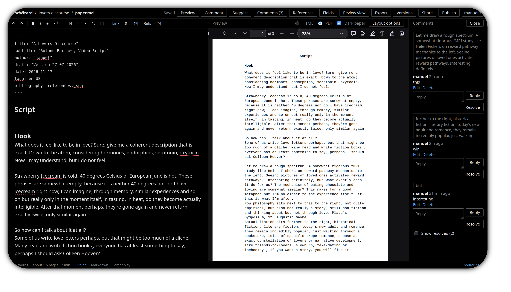

# DocWizard

[](https://github.com/LoredCast/DocWizard/actions/workflows/ci-cd.yml)
[](https://github.com/LoredCast/DocWizard/tags)
[](https://github.com/LoredCast/DocWizard/pkgs/container/docwizard-app)

DocWizard is a self-hosted writing app for papers, theses, and other long-form documents. Write in Pandoc Markdown or LaTeX, collaborate in your browser, and export to PDF, Word, or the web. Layouts handle formatting separately, so you can change how a document looks without rewriting it.



## Features

- **Write and revise.** Edit online or offline, search across a project, and compare or restore previous versions. Projects are stored as plain files on disk.
- **Collaborate and review.** Edit together live, leave comments, and accept or reject suggested changes. Share a formatted review link with people who don’t use Markdown, or import Word documents with their comments and tracked changes.
- **Manage references.** Use Zotero, BibTeX, CSL-JSON, or RIS with citation autocomplete, DOI/ISBN/arXiv lookup, and cross-references for figures, tables, and equations.
- **Choose a layout.** Start with a thesis, journal article, manuscript, or screenplay template. Customize fonts, margins, and title pages at `/layouts` with a live PDF preview.
- **Export and publish.** Preview in HTML or PDF, export to PDF (Typst or LaTeX), DOCX, ODT, EPUB, or HTML, or publish as a static site.
- **Sync and control access.** Sync projects with WebDAV, Git, or a server folder. Use local accounts with two-factor authentication or sign in through OpenID Connect.

## Quick start

The Docker Compose stack runs the app, render worker, and Caddy. Prebuilt images are available for amd64 and arm64.

```sh
curl -fsSLO https://raw.githubusercontent.com/LoredCast/DocWizard/main/deploy/compose.yaml
curl -fsSL https://raw.githubusercontent.com/LoredCast/DocWizard/main/deploy/docwizard.example.toml -o docwizard.toml
```

Set `public_url` in `docwizard.toml` to your app’s address, then start the stack and create an admin account:

```sh
docker compose up -d
docker compose exec app python -m docwizard create-admin you
```

By default, Caddy listens on `127.0.0.1:8080` for the app and `127.0.0.1:8081` for publishing and previews. If you use an external reverse proxy, forward `Host`, `X-Forwarded-Proto`, and WebSocket connections. For Caddy-managed HTTPS, use the [TLS Compose override](deploy/compose.ssl.yaml).

Set `DOCWIZARD_TAG` to `latest` or a specific version for a tagged release. The default, `main`, tracks rolling builds; `nightly` tracks prereleases.

## Development

Requires Python 3.12+, Pandoc 3.9+, and Typst 0.14+. Install TeX Live with `latexmk` and LuaLaTeX if you need LaTeX builds.

```sh
python -m venv .venv
. .venv/bin/activate
pip install --require-hashes -r requirements.lock
pip install -e '.[dev]'

python -m docwizard check
python -m docwizard create-admin you
DOCWIZARD_RENDER_SPAWN_WORKER=true python -m docwizard serve
```

Open `http://localhost:8080`. Local data is stored in `./data/`. Run `pytest` to test.

## Documentation

- [Example configuration](deploy/docwizard.example.toml) — server settings, email, authentication, and sync
- [Deployment files](deploy/) — Docker, Caddy, and systemd
- [Built-in layouts](layouts/) — templates and layout-specific options
- [Architecture](ARCHITECTURE.md) — storage, collaboration, and rendering

## License

[GNU Affero General Public License v3.0 or later](LICENSE).
